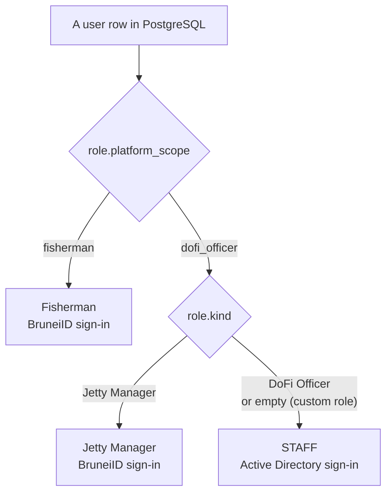
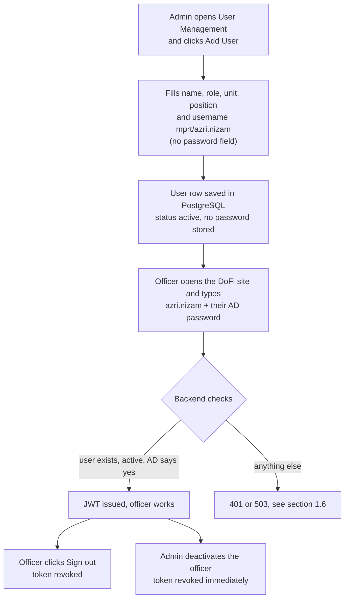

# 1. Business context and features

## 1.1 The problem

DoFi (Department of Fisheries) staff used to sign in with a **username and a password stored in DoFi's own database**.
The Add User form even generated a temporary password. That has three problems for a government system:

- A second set of passwords for people who already have a government AD account (to reset, to leak, to forget).
- No central control: disabling someone in AD did not stop them signing in to DoFi.
- Passwords handed over by email or chat.

The decision: **internal staff authenticate against the government Active Directory** (`MPRT.EG.GOV.BN`, NetBIOS name
`MPRT`). DoFi stops storing or issuing staff passwords.

## 1.2 Who signs in how

The system has three kinds of people. Only the first changed.

| Who | Role rule | How they sign in | Changed? |
|---|---|---|---|
| **Staff**: DoFi Officer and any custom DoFi role | `platform_scope = dofi_officer` and `kind` is not `Jetty Manager` | **Active Directory** (mock in local and staging) | **Yes** |
| **Jetty Manager** | `kind = Jetty Manager` | BruneiID (as before) | No |
| **Fisherman** | `platform_scope = fisherman` | BruneiID (as before) | No |

In code this rule is `Role.directory_managed` (a scope) and `Role#directory_managed?`; users have the same two names.
`kind` can be empty for custom roles, which is why the SQL uses `IS DISTINCT FROM 'Jetty Manager'` rather than
`kind != ...` (a `NULL` would silently drop custom roles).

## 1.3 Division of responsibility

This is the most important idea. **AD never creates users and never assigns roles.**

| AD (or the mock) decides | DoFi (PostgreSQL) decides |
|---|---|
| Is this password correct for this account? | Does a DoFi user with this username exist? |
| | Is the user `active` and not soft-deleted? |
| | What role and permissions does the user have? |

Consequences:

- A person with a valid AD account but **no DoFi user** cannot sign in (401, and nothing is created).
- A DoFi user whose AD password is wrong or whose AD account is disabled cannot sign in.
- To onboard an officer: an admin creates the user in User Management (**no password field**), with the username
  `mprt/<their AD name>`. That is the whole onboarding.
- To offboard: deactivate the user in DoFi. Their existing token dies immediately (see
  [05](05-token-revocation-and-security.md)). Disabling them in AD additionally blocks the next sign-in.

## 1.4 Business flow

### Onboarding and daily use

### Day-to-day lifecycle events

| Event | What the business sees | What the system does |
|---|---|---|
| New officer joins | Admin adds the user | Row created; the officer signs in with their AD password |
| Officer leaves | Admin deactivates (or deletes) the user | Next request with the old token is refused (401) |
| Officer on leave / suspended | Admin suspends | Same: refused at once |
| Officer returns | Admin reactivates | **Old tokens stay dead**; the officer signs in again |
| Officer's AD name changes | Admin edits the username | Old username stops working, old token is revoked |
| Officer's phone, unit, position change | Admin edits profile | Nothing happens to their session |
| AD is down | Staff cannot sign in (503) | Fishermen and Jetty Managers are unaffected |

## 1.5 Features

| # | Feature | Where it is implemented |
|---|---|---|
| F1 | Staff sign in with their AD username and password | `OfficerLogin`, `LdapAuthenticator` |
| F2 | Username typed in any common spelling: `azri.nizam`, `Azri.Nizam`, `MPRT/azri.nizam`, `MPRT\azri.nizam` | `DirectoryUsername` |
| F3 | Encrypted, verified connection to AD (LDAPS, certificate and host name checked, TLS 1.2+) | `LdapAuthenticator#tls_options` |
| F4 | Several domain controllers with failover, without multiplying AD lockout counters | `AD_HOST` list, see 3.6 |
| F5 | Mock directory for local and staging with one shared password per environment | `MockLdapAuthenticator` |
| F6 | Simulate "AD is down" on demand (password `simulate-ad-unavailable`) | `MockLdapAuthenticator` |
| F7 | Mock is impossible on production (boot refuses) | `DirectoryConfig`, `DEPLOY_ENV` |
| F8 | No local password for staff, in any environment | `User#valid_password?` |
| F9 | Add User has no password field and returns no temporary password | `Admin::UsersController` |
| F10 | Logout kills the token on the server | devise-jwt revocation + `JTIMatcher` |
| F11 | Deactivated / suspended / discarded users are refused even with a valid token | `User#active_for_authentication?` |
| F12 | Re-enabling a user does not bring old tokens back | `User#revoke_tokens` |
| F13 | Changing a username ends the old session | `User#token_revocation_needed?` |
| F14 | Superadmin seed from `ADMIN_AD_USERNAME`; production refuses a placeholder | `db/seeds/admin_user.rb` |
| F15 | Demo accounts with a known password are never seeded on production | `db/seeds.rb` |
| F16 | Remap an existing user to a real AD name | `rake admin:assign_ad_username` |
| F17 | Audit-friendly structured logs (no passwords) | `ad.login`, `ad.directory_unavailable` events |

## 1.6 What the user sees

| Situation | HTTP | Message to the user |
|---|---|---|
| Signed in | 200 | (normal sign-in response, unchanged) |
| Wrong password | 401 | Generic invalid credentials |
| Username does not exist | 401 | The **same** generic message |
| User inactive, suspended or discarded | 401 | The **same** generic message |
| Two DoFi users match the typed name | 401 | The same generic message (logged as `ambiguous_username`) |
| AD unreachable, certificate problem, timeout, bad server config | 503 | "Sign-in is temporarily unavailable. Please try again later." |
| More than 10 sign-in attempts per minute from one IP | 429 | "Too many requests." (Rack::Attack) |

The identical 401 for every refusal is deliberate: the response must not reveal whether an account exists or why it
was refused (account enumeration). The real reason is only in the server log.

## 1.7 Business rules (the contract)

These came from the client and the security review. Tests pin each of them.

1. AD is mandatory for **all** staff, including custom DoFi roles. There is no "disabled" mode and no local password.
2. Local and staging use `mock`; production uses `ldap`. Mock must be impossible to turn on in real production.
3. In mock mode every staff user has their own username but they all share **one** password, set once per environment
   in that environment's `.env`. It is never committed and never stored as a user's password.
4. Even with the correct mock password, an unknown, inactive, suspended or discarded user is refused.
5. Jetty Managers and Fishermen sign in exactly as before.
6. Logging out revokes the token on the server. A deactivated user's old token stops working, and re-enabling the user
   does **not** make it work again.
7. Changing a username revokes tokens. Changing name, phone, position, unit, email or locale does **not**.
8. Production seeds need a real AD username for the superadmin and create no demo accounts.
9. There is no application-level break-glass bypass; emergencies use a controlled server session (see the runbook).

## 1.8 Out of scope (deliberately not done)

| Not done | Why |
|---|---|
| Creating DoFi users or roles from AD | AD is only a password checker; DoFi owns authorization |
| AD group gating (e.g. "only members of group X") | Not requested; open question with the client |
| MFA / single sign-on | Not requested |
| Per-username login throttle | Needs limits from Security; today only the existing per-IP limit exists |
| In-app break-glass account | Needs Security approval and its own design; must never reuse mock |
| Frontend changes | The frontend repo is separate; the required behaviour is documented in the runbook |
