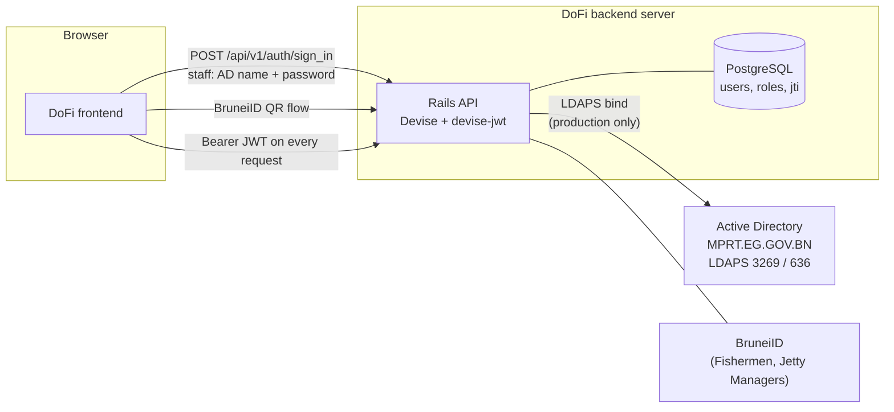
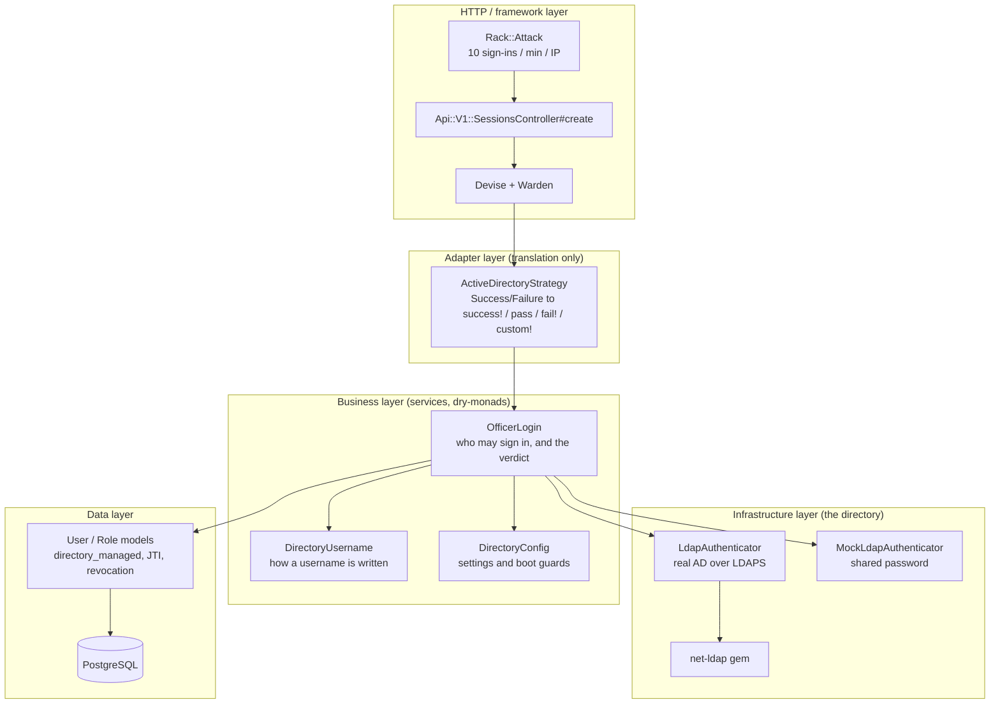
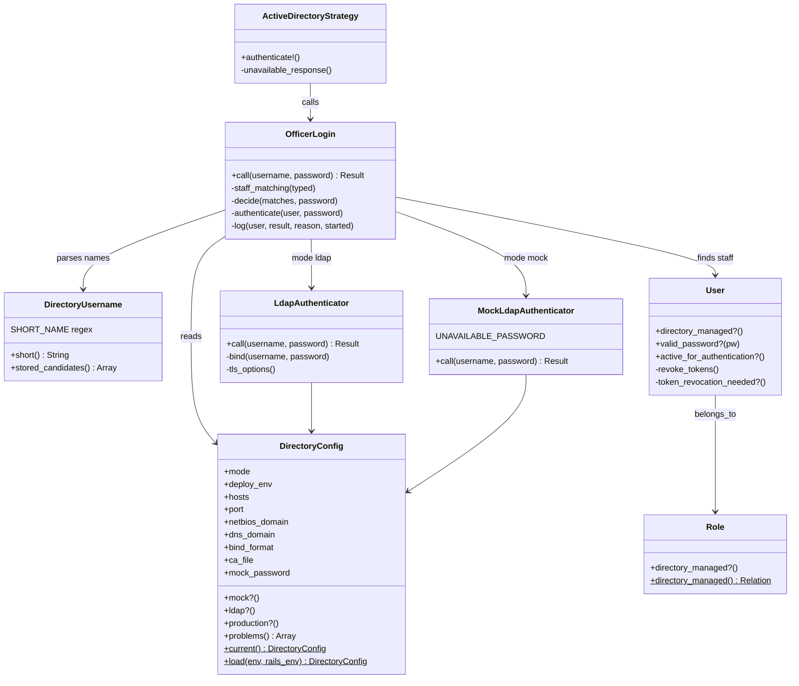
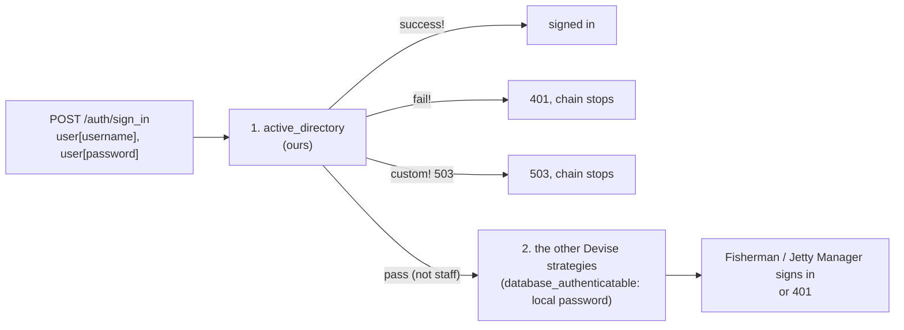
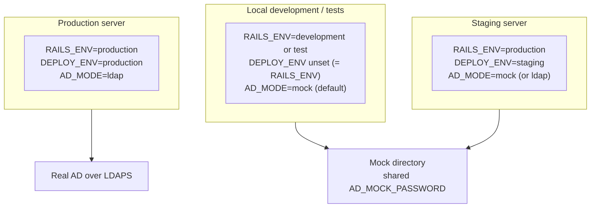
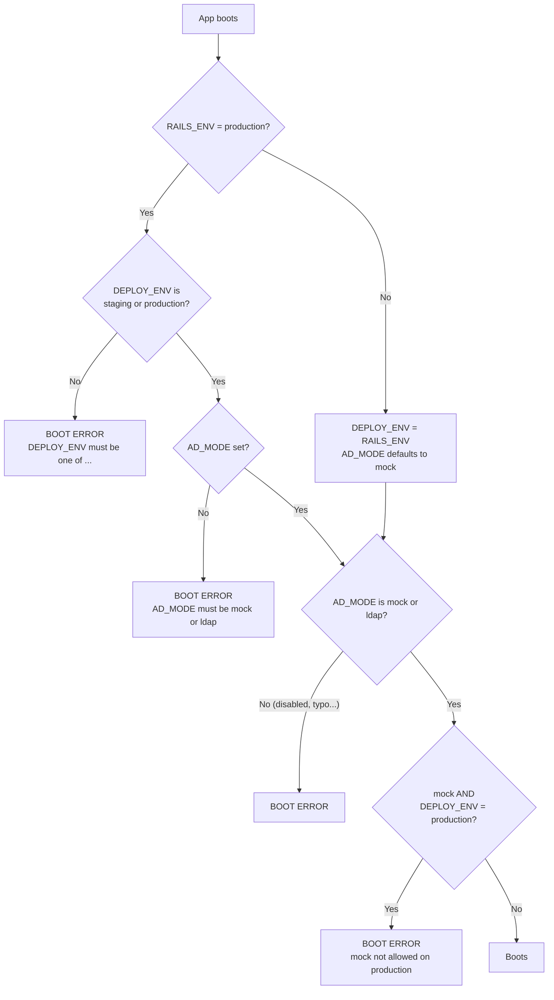

# 2. Architecture

## 2.1 System context

Who talks to whom. The only new external dependency is Active Directory, and only in production.



In local and staging the arrow to AD does not exist: `MockLdapAuthenticator` answers inside the Rails process.

## 2.2 Layers

The code follows the repository's thin-layer rules ([`CLAUDE.md`](../../CLAUDE.md)): each class has one job.



| Layer | Class | Single responsibility | Knows nothing about |
|---|---|---|---|
| Adapter | `ActiveDirectoryStrategy` | Translate `OfficerLogin`'s answer to Warden calls | LDAP, roles, status rules |
| Business | `OfficerLogin` | Find the staff user, check eligibility, ask the directory, log | HTTP, Warden, LDAP networking |
| Business | `DirectoryUsername` | Turn typed text into stored-username candidates / the AD short name | Users, the database, AD |
| Business | `DirectoryConfig` | Read and validate every AD setting once | Everything else |
| Infrastructure | `LdapAuthenticator` | One LDAPS bind with TLS, timeouts, failover | Users, roles, DoFi accounts |
| Infrastructure | `MockLdapAuthenticator` | The same contract as `LdapAuthenticator`, with a shared password | Users, roles |
| Data | `User`, `Role` | Who is staff; token revocation | LDAP, HTTP |

### The shared contract (Liskov)

`LdapAuthenticator` and `MockLdapAuthenticator` are interchangeable. Both implement:

```
call(username:, password:)  ->  Success(:authenticated)
                             |  Failure(:invalid_credentials)    the directory said no
                             |  Failure(:directory_unavailable)  the directory could not be asked
```

`OfficerLogin` receives one of them (by default chosen from `AD_MODE`) and never branches on which it is. A shared
test module (`test/support/directory_authenticator_contract.rb`) runs the same assertions against both classes, so any
future authenticator must honour the same contract.

## 2.3 Class diagram



`DirectoryConfig` is a Ruby `Data` object: immutable, built once, read everywhere. That is why tests can pass a
different config to any service instead of changing global state.

## 2.4 Which strategy answers? (Warden order)

Devise keeps an ordered list of Warden strategies for the `user` scope. `devise.rb` puts ours **first**:



Why "first" matters: for a staff user the strategy answers `success!`, `fail!` or `custom!`, all of which **stop the
chain**. The local password strategy is never consulted. It only runs when ours says `pass` ("not mine"), which
happens for usernames that are not staff.

As a second wall, `User#valid_password?` returns `false` for staff, so even if a code change one day let the chain
reach `database_authenticatable`, a staff user still could not get in with whatever hash their row might hold.

## 2.5 Environments



| | Local / tests | Staging | Production |
|---|---|---|---|
| `RAILS_ENV` | development / test | **production** | production |
| `DEPLOY_ENV` | unset (falls back to `RAILS_ENV`) | `staging` | `production` |
| `AD_MODE` | `mock` (default) | `mock`, or `ldap` to try the real AD | `ldap` (required) |
| Staff password | shared `AD_MOCK_PASSWORD` | shared `AD_MOCK_PASSWORD` | each person's AD password |
| Demo seeds | loaded | loaded | **never** |

### Why `DEPLOY_ENV` exists

`RAILS_ENV=production` is true on **both** staging and production, so the code cannot tell them apart. A second
variable, `DEPLOY_ENV`, says which deployment it is. It is set in each deployment's **compose file**, not in the
server's `.env`: in Docker Compose an `environment:` entry overrides `env_file`, so a stray line in a `.env` cannot flip
production to staging. `test/config/deployment_environment_test.rb` reads the compose files and fails if an edit weakens
this.

## 2.6 The boot guard

`DirectoryConfig.load` runs when the app boots (and for `db:prepare`, `db:seed` and the console). It **raises** if the
combination is unsafe, so a typo cannot silently leave staff on a weaker path.



Anything that is wrong but not dangerous does **not** stop the boot, it makes sign-in answer 503. For example, a
missing `AD_HOST` or an unreadable CA file: `DirectoryConfig#problems` lists the reasons, the authenticator logs them
and returns `directory_unavailable`. The app stays up for Fishermen and Jetty Managers.

## 2.7 Data model touched

No new table and no new column. AD reuses existing data:

| Column | Role in AD sign-in |
|---|---|
| `users.username` | The sign-in identity. Staff: `mprt/<ad name>`. Changing it revokes tokens. |
| `users.status` | `active` is required to sign in. `inactive` and `suspended` deny access. |
| `users.discarded_at` | Soft delete (Discard). Non-null denies access. |
| `users.fisherman_status` | The Fisherman's lifecycle; `suspended` and `revoked` deny access. |
| `users.jti` | The token id. Changing it kills every token issued before. |
| `users.encrypted_password` | Empty for staff: no password is required or stored (`User#password_required?`). |
| `roles.platform_scope`, `roles.kind` | Decide whether a user is staff. |

## 2.8 Design decisions and why

| Decision | Reason |
|---|---|
| Warden strategy instead of a custom controller | The endpoint, the JWT dispatch and the response body stay exactly as they were. |
| `OfficerLogin` returns `dry-monads` results | The repository's service convention; no exceptions for expected failures; `case/in` pattern matching in the strategy. |
| Two authenticator classes with one contract | Local and staging can run without an AD server; production code path is identical above the authenticator. |
| `AD_MODE` has no `disabled` value | A "turn it off" switch is how a typo ends with staff on a weaker path. |
| `DirectoryConfig` is the only reader of `ENV` | One place to validate; everything else receives a config object (testable, injectable). |
| Reuse `JTIMatcher` for revocation | Already installed, already revokes on sign-out, no new table or cache. |
| Reuse Devise's `active_for_authentication?` | Devise already calls it on every authenticated request, JWT included. |
| Identical 401 for every refusal | Prevents account enumeration. |
| Bind identity built from the **stored** username | Typed text never reaches the LDAP bind identity, so no LDAP-injection style tricks. |
| Mock password is one shared value, not per user | Matches how the client wants to test: many officers, one environment password, no extra storage. |
