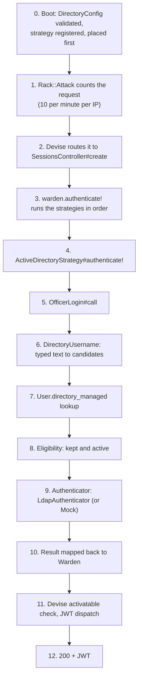

# 3. Code walkthrough

We follow **one real sign-in** from the HTTP request to the JWT, file by file, then look at the supporting pieces.
Open the source files beside this page; excerpts here are short on purpose.

## 3.1 The request we trace

```http
POST /api/v1/auth/sign_in
Content-Type: application/json

{ "user": { "username": "MPRT/Azri.Nizam", "password": "••••••••" } }
```

The stored user is `username = "mprt/azri.nizam"`, role `DoFi Officer`, `status = "active"`. `AD_MODE=ldap`.

## 3.2 Step by step



### Step 0: boot (`config/initializers/directory_authentication.rb`, `devise.rb`)

```ruby
# config/initializers/directory_authentication.rb
Rails.application.config.to_prepare do
  Warden::Strategies.add(:active_directory, Authentication::ActiveDirectoryStrategy)
end

Rails.application.config.after_initialize do
  config = Authentication::DirectoryConfig.current   # raises on an unsafe combination
  ...
end
```

```ruby
# config/initializers/devise.rb
config.warden do |warden_config|
  warden_config.default_strategies(scope: :user).unshift :active_directory   # unshift = first in line
end
```

- `to_prepare` runs after each code reload in development, so the strategy name always points at the current class.
- `after_initialize` reads `DirectoryConfig.current` purely for its side effect: if `AD_MODE`/`DEPLOY_ENV` are
  inconsistent the app does not start (see [2.6](02-architecture.md#26-the-boot-guard)).
- `unshift` puts our strategy at the front of Devise's list.

### Step 1: throttling (`config/initializers/rack_attack.rb`)

`POST /api/v1/auth/sign_in` is limited to 10 per minute per IP. Over the limit the request is answered with 429 before
any of our code runs. (There is no per-username limit yet; see "known gaps" in the runbook.)

### Steps 2 and 3: Devise and Warden (`app/controllers/api/v1/sessions_controller.rb`)

```ruby
def create
  self.resource = warden.authenticate!(auth_options)
  sign_in(resource_name, resource)
  access_token = request.env["warden-jwt_auth.token"]
  render json: { status: "success", data: { access_token:, user: UserBlueprint.render_as_hash(resource) }... }
end
```

This controller **was not changed** for AD. `warden.authenticate!` walks the strategy list. A Devise strategy is only
tried when its `valid?` is true; for a params-based strategy that means "this is the sign-in `create` action and the
params contain `user[username]` and `user[password]`". That is also why our strategy never runs on ordinary API calls:
those carry a Bearer token and no `user[...]` params, so only the JWT strategy handles them.

### Step 4: the strategy (`app/strategies/authentication/active_directory_strategy.rb`)

```ruby
def authenticate!
  case OfficerLogin.call(username: authentication_hash[:username], password:)
  in Success(user)                     then success!(user)
  in Failure(:not_applicable)          then pass
  in Failure(:directory_unavailable)   then custom!(unavailable_response)
  in Failure(_)                        then fail!(:invalid)
  end
end
```

The strategy contains **no rules**. It only translates:

| `OfficerLogin` returned | Warden call | Effect |
|---|---|---|
| `Success(user)` | `success!(user)` | The user is authenticated; the chain stops |
| `Failure(:not_applicable)` | `pass` | "Not my user": Devise tries the next strategy (Fishermen, Jetty Managers) |
| `Failure(:directory_unavailable)` | `custom!([503, headers, body])` | A ready-made 503 response; the chain stops |
| `Failure(anything else)` | `fail!(:invalid)` | 401 through Devise's failure app; the chain stops |

`case/in` with `Success(...)`/`Failure(...)` patterns works because `dry-monads` results support Ruby pattern matching.

### Step 5: the decision (`app/services/authentication/officer_login.rb`)

```ruby
def call(username:, password:)
  started = Process.clock_gettime(Process::CLOCK_MONOTONIC)
  matches = staff_matching(username)
  return Failure(:not_applicable) if matches.empty?

  user, result, reason = decide(matches, password)
  log(user:, result:, reason:, started:)
  result
end
```

Read it as three sentences: *find staff for this text; if none, it is not our business; otherwise decide, log and
return.* Note that `:not_applicable` is **not logged** here: it is the normal path for every Fisherman sign-in.

The constructor takes its collaborators, so tests can swap them:

```ruby
def initialize(config: DirectoryConfig.current, authenticator: nil, logger: ApplicationLogger)
  @authenticator = authenticator || (config.mock? ? MockLdapAuthenticator : LdapAuthenticator).new(config:)
```

### Step 6: usernames (`app/services/authentication/directory_username.rb`)

```ruby
DirectoryUsername.new("MPRT/Azri.Nizam", domain: "MPRT")
  .stored_candidates   # => ["mprt/azri.nizam", "azri.nizam"]
  .short               # => "azri.nizam"
```

It lower-cases, strips one leading `MPRT\` or `MPRT/`, and validates the remainder with
`SHORT_NAME = /\A[a-z0-9._-]{1,64}\z/`. Two outputs:

- `stored_candidates`: the spellings a **database row** might use (`mprt/azri.nizam`, `azri.nizam`). Used for the lookup.
- `short`: the plain AD name, or `nil` if the text is not a plausible AD name (another domain, spaces, quotes, `*`,
  `(`, too long). Used for the bind.

Control characters (`\0`, newlines, tabs) make the whole input empty. This was a real bug found in testing:
`String#strip` silently removes a trailing NUL, so `"azri\0"` used to pass.

### Step 7: finding the staff user

```ruby
def staff_matching(typed)
  candidates = directory_username(typed).stored_candidates
  candidates.empty? ? [] : User.directory_managed.where(username: candidates).limit(2).to_a
end
```

`User.directory_managed` restricts the search to staff, so a Fisherman or Jetty Manager typing a username never matches
and the strategy `pass`es. `limit(2)` is enough to detect ambiguity without loading more rows.

```ruby
# app/models/role.rb
def self.directory_managed
  where(platform_scope: DOFI_OFFICER_PLATFORM).where("roles.kind IS DISTINCT FROM ?", JETTY_MANAGER)
end

# app/models/user.rb
scope :directory_managed, -> { where(role_id: Role.directory_managed) }
```

### Step 8: eligibility and ambiguity

```ruby
def decide(matches, password)
  return [nil, Failure(:invalid_credentials), "ambiguous_username"] unless matches.one?
  authenticate(matches.first, password)
end

def authenticate(user, password)
  return [user, Failure(:invalid_credentials), "ineligible_account"] unless user.kept? && user.active?
  short = directory_username(user.username).short
  return [user, Failure(:invalid_credentials), "invalid_stored_username"] if short.nil?

  result = authenticator.call(username: short, password:)
  [user, result.fmap { user }, nil]
end
```

- **Ambiguous**: both `azri.nizam` and `mprt/azri.nizam` exist as separate rows. Nobody signs in; it is logged.
- **Ineligible**: discarded or not `active`. **The directory is never asked**, so an inactive user costs no AD round trip
  and cannot lock an AD account.
- **Bind name from the stored row**: `directory_username(user.username).short`, not the typed text. What reaches AD is
  always derived from the database row that matched.
- `result.fmap { user }` turns `Success(:authenticated)` into `Success(user)` and leaves failures untouched.

### Step 9a: the real directory (`ldap_authenticator.rb`)

```ruby
def call(username:, password:)
  return Failure(:invalid_credentials) unless usable?(username, password)
  return unavailable("misconfigured", problems: config.problems) if config.problems.any?
  bind(username, password)
rescue *UNAVAILABLE_ERRORS => e
  unavailable(e.class.name)
end
```

The four guards, in order:

1. **`usable?`**: blank password, NUL, longer than 256 characters, or a name that is not a valid short name → 401
   without touching the network. A blank password is the critical one: an LDAP simple bind with an empty password is an
   *unauthenticated bind*, which many servers answer with **success**.
2. **`config.problems`**: missing host, IP address instead of DNS name, port 389, unreadable CA file, bad timeouts →
   503, not an attempt.
3. **`bind`**: the real work (below).
4. **`rescue`**: any network, TLS or timeout error → 503, logging only the exception **class**, never its message.

```ruby
def bind(username, password)
  ldap = build_ldap(bind_identity(username), password)
  return Success(:authenticated) if Timeout.timeout(total_timeout) { ldap.bind }

  code = ldap.get_operation_result&.code
  return Failure(:invalid_credentials) if code == Net::LDAP::ResultCodeInvalidCredentials   # 49
  unavailable("result_code_#{code}")
end
```

`ldap.bind` returns true on success. On failure, LDAP result code **49** means "invalid credentials" (wrong password,
unknown, disabled, locked or expired account: AD does not say which). Any other code (server busy, protocol error...) is
treated as *unavailable*, not as a wrong password, so a directory problem never looks like a user mistake.

```ruby
def build_ldap(identity, password)
  ldap_class.new(hosts: config.hosts.map { [it, config.port] }, connect_timeout: config.connect_timeout,
                 encryption: { method: :simple_tls, tls_options: tls_options },
                 auth: { method: :simple, username: identity, password: password })
end

def bind_identity(username)
  config.bind_format == "upn" ? "#{username}@#{config.dns_domain}" : "#{config.netbios_domain}\\#{username}"
end
```

`simple_tls` means the TCP connection is wrapped in TLS from the first byte (LDAPS). `bind_identity` builds
`MPRT\azri.nizam` (netbios) or `azri.nizam@MPRT.EG.GOV.BN` (upn).

```ruby
def tls_options
  options = OpenSSL::SSL::SSLContext::DEFAULT_PARAMS.merge(verify_mode: OpenSSL::SSL::VERIFY_PEER,
                                                           min_version: OpenSSL::SSL::TLS1_2_VERSION)
  config.ca_file ? options.merge(ca_file: config.ca_file) : options
end
```

net-ldap does **not** verify the server certificate unless told to. `VERIFY_PEER` makes it check the chain; net-ldap
then checks that the certificate matches the host name we dialled (that is why `AD_HOST` must be a DNS name, never an
IP). `ca_file` lets the container trust the government CA.

`total_timeout = connect_timeout × hosts + operation_timeout` bounds the whole call, because net-ldap only times out
connecting and the TLS handshake, not the wait for the bind answer.

### Step 9b: the mock (`mock_ldap_authenticator.rb`)

```ruby
def call(username:, password:)
  return Failure(:invalid_credentials) if username.blank? || password.blank?
  return Failure(:directory_unavailable) if config.problems.any? || password == UNAVAILABLE_PASSWORD

  return Success(:authenticated) if ActiveSupport::SecurityUtils.secure_compare(password, config.mock_password)
  Failure(:invalid_credentials)
end
```

- Same contract as the real one, so `OfficerLogin` does not care which it has.
- `secure_compare` compares in constant time (no timing leak of the shared password).
- A blank `AD_MOCK_PASSWORD` shows up in `config.problems` ("AD_MOCK_PASSWORD is not set") → **503, never a login**.
  A forgotten variable is loud, and nobody gets in by sending an empty password.
- The password `simulate-ad-unavailable` returns 503 on purpose, so the frontend team can test the outage screen.
- The mock does not know about users. `OfficerLogin` already decided that the user exists, is staff and is active
  *before* the mock is asked. That is why an unknown or inactive user is refused even with the right mock password.

### Step 10: logging (`OfficerLogin#log`)

```ruby
logger.call(event: "ad.login", level: result.success? ? :info : :warn, user_id: user&.id,
            params: { mode: config.mode, outcome:, reason: reason || (result.failure if result.failure?), duration_ms: ... })
```

One structured JSON line per decision: mode, `success`/`failure`, the reason (`invalid_credentials`,
`ineligible_account`, `ambiguous_username`, `directory_unavailable`...), the local user id and the duration. **Never**
the password and never what the user typed. `ApplicationLogger` also filters sensitive parameter names.

### Step 11: Devise finishes the job

After `success!(user)`, Warden calls its `after_set_user` hooks. Devise's **activatable** hook calls
`user.active_for_authentication?` (we override it, see [05](05-token-revocation-and-security.md)); if it is false the
sign-in is turned into a 401. Then `sign_in` runs, devise-jwt matches the request against `dispatch_requests`
(`POST /api/v1/auth/sign_in`), creates a JWT containing `users.jti` and puts it in `request.env["warden-jwt_auth.token"]`,
and the controller renders it.

---

## 3.3 Supporting pieces

### `DirectoryConfig`: one reader of `ENV`

[`directory_config.rb`](../../app/services/authentication/directory_config.rb) is a `Data.define` value object with
three jobs:

| Method | Job |
|---|---|
| `load(env, rails_env:)` | Build the config from an env hash. Raises `ArgumentError` on unsafe combinations (boot guard). Takes `env` as an argument so tests never mutate the real `ENV`. |
| `current` | `load` once and memoize. What production code calls. |
| `problems` | Reasons the current mode cannot work. Empty means usable. Used by the authenticators to answer 503 instead of trying a half-configured bind. |

Raise vs. report is a deliberate split: *dangerous* misconfiguration (`mock` on production, unknown mode) **raises at
boot**; *incomplete* configuration (no host yet) is reported by `problems` and answered with 503 at runtime.

### The `User` model (`app/models/user.rb`)

| Member | Purpose |
|---|---|
| `scope :directory_managed` / `directory_managed?` | Is this user staff? |
| `password_required?` → `false` for staff (and for a user not yet given a role) | No password is asked for or stored (`encrypted_password` stays empty) |
| `valid_password?` → `false` for staff | Defense in depth: the local password can never admit staff, whatever a row holds |
| `active_for_authentication?` | Refuse inactive, suspended, revoked and discarded users on every request |
| `inactive_message` → `:invalid` | A refused user gets the generic 401, not "account disabled" |
| `before_save :revoke_tokens` (conditional) | Rotate `jti` when access is removed or the username changes |

### The admin seed and rake task

- [`db/seeds/admin_user.rb`](../../db/seeds/admin_user.rb): `find_or_create_by!` on `admin@dofi.gov.bn`. The block only
  runs on **create**, so an existing row is never modified. Production requires `ADMIN_AD_USERNAME` and aborts with a
  clear message otherwise (no placeholder). No password is set: staff need none (`User#password_required?`).
- [`lib/tasks/admin.rake`](../../lib/tasks/admin.rake): `admin:assign_ad_username EMAIL=... AD_USERNAME=...` remaps an
  **existing** staff row (for example the old placeholder). It validates the name, refuses duplicates, and goes
  through `update!` so the username change also rotates `jti`. It uses `AD_USERNAME` rather than `USERNAME` because
  shells already export `USERNAME` as your OS user.
- [`db/seeds.rb`](../../db/seeds.rb): reference data always; demo data (companies, vessels, crews, manifests and the
  demo Fisherman / Jetty Manager users with the known password) only when `DEPLOY_ENV` is not `production`.

### `Admin::UsersController` and `Users::Create`

`password` and `password_confirmation` were removed from the permitted params and `temporary_password` from the
response. If a client still sends a password it is ignored. Devise normally forces a password on every user, so `User`
overrides `password_required?` to be false for staff: `Users::Create` sets none, and `users.encrypted_password` stays at
its empty default. A one-off migration (`BlankStaffEncryptedPasswords`) cleared the hashes that earlier versions had
stored, including the published default one on the seeded superadmin.

## 3.4 Where each failure becomes what

| Cause | Detected in | Result type | HTTP |
|---|---|---|---|
| Not a staff username | `OfficerLogin#staff_matching` | `Failure(:not_applicable)` | Devise carries on (usually 401 later) |
| Two rows match | `OfficerLogin#decide` | `Failure(:invalid_credentials)` | 401 |
| Inactive / discarded | `OfficerLogin#authenticate` | `Failure(:invalid_credentials)` | 401 |
| Blank / NUL / too long password | `LdapAuthenticator#usable?` | `Failure(:invalid_credentials)` | 401 |
| AD says code 49 | `LdapAuthenticator#bind` | `Failure(:invalid_credentials)` | 401 |
| Wrong mock password | `MockLdapAuthenticator#call` | `Failure(:invalid_credentials)` | 401 |
| Missing/invalid AD settings | `DirectoryConfig#problems` | `Failure(:directory_unavailable)` | 503 |
| TLS error, timeout, refused connection | `LdapAuthenticator` rescue | `Failure(:directory_unavailable)` | 503 |
| Any other LDAP result code | `LdapAuthenticator#bind` | `Failure(:directory_unavailable)` | 503 |
| Deactivated user with an old JWT | Devise `active_for_authentication?` | n/a | 401 |

## 3.5 Why the code looks this way

- **Why `Failure(:not_applicable)` instead of `nil` or an exception?** The strategy must distinguish "not staff, let
  Devise continue" from "staff, refused". Mixing them would let a refused staff user fall into the local-password
  path.
- **Why does `OfficerLogin` build the authenticator, not the strategy?** The strategy is the only Warden-aware class;
  keeping Warden out of the service means the service can be tested with plain Ruby and injected fakes.
- **Why `limit(2)` and not `first`?** `first` would silently pick one of two matching rows.
- **Why no `rescue => e` in `OfficerLogin`?** Expected failures are values (`Failure`), and the authenticator already
  converts network errors. A bug should surface, not be swallowed into a 503.

## 3.6 Host failover and lockouts

`AD_HOST` can list several domain controllers: `ad1.example,ad2.example,ad3.example`. net-ldap tries the next host only
when it **cannot connect or finish TLS**. If a host answers and rejects the password, the attempt ends there. If it
retried every host, one wrong password would count against the AD lockout counter once per domain controller and lock
an officer out faster. This is net-ldap's documented behaviour and `LdapAuthenticator` makes a single bind attempt, so
it is not covered by a dedicated test; keep it in mind if you ever replace the library.
