# 4. Sequence diagrams

Each diagram is one scenario. Participants:

- **FE**: the DoFi frontend (browser)
- **Rack**: Rack::Attack and Devise middleware
- **Strategy**: `ActiveDirectoryStrategy`
- **Login**: `OfficerLogin`
- **Auth**: `LdapAuthenticator` or `MockLdapAuthenticator`
- **DB**: PostgreSQL
- **AD**: Active Directory

## 4.1 Successful staff sign-in (production, `AD_MODE=ldap`)

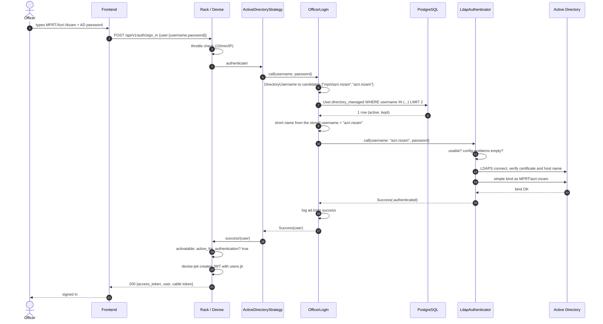

## 4.2 Successful staff sign-in (local / staging, `AD_MODE=mock`)

Identical above the authenticator. Only steps 11 to 13 change:

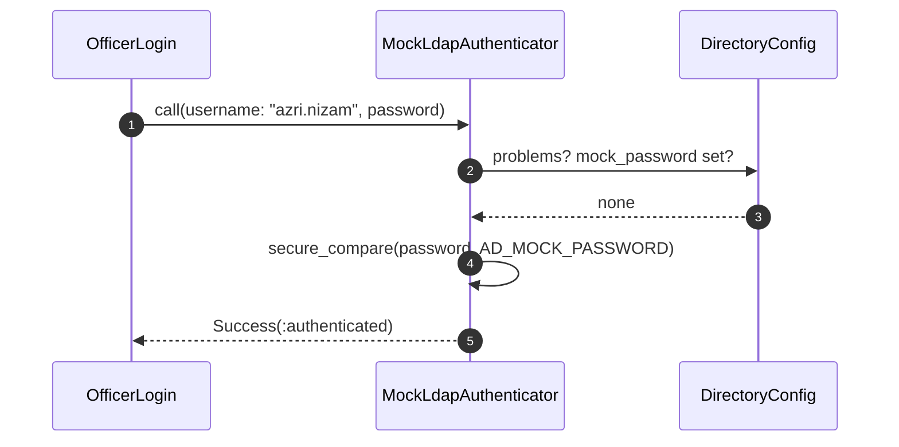

No network, no AD. Any staff user, one shared password.

## 4.3 Wrong password

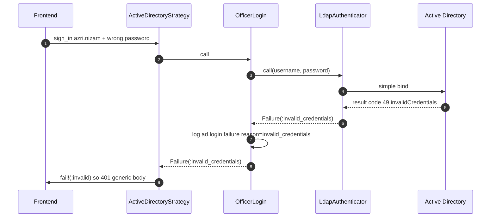

Only one domain controller is asked: a rejection is never replayed on the next host (lockout protection).

## 4.4 Unknown user, inactive user, Fisherman (the directory is not asked)

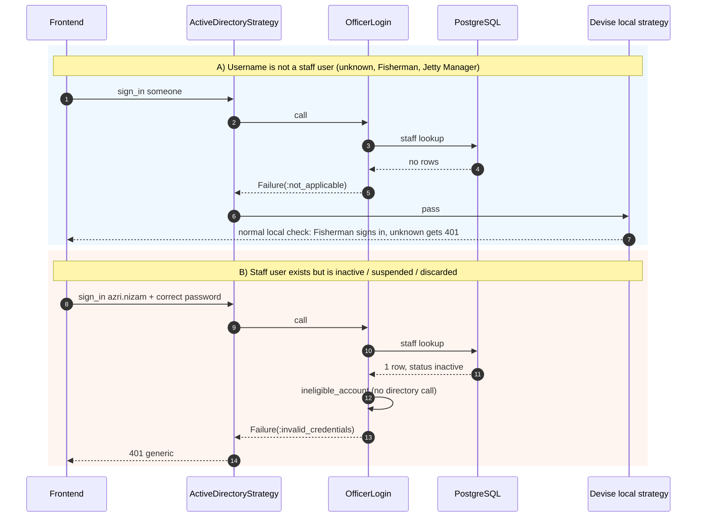

## 4.5 Directory unavailable (503)

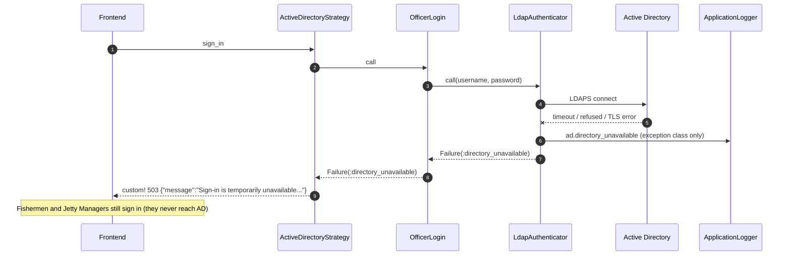

The same 503 appears when the configuration is incomplete (`config.problems` is not empty), without any network call.

## 4.6 Sign-out

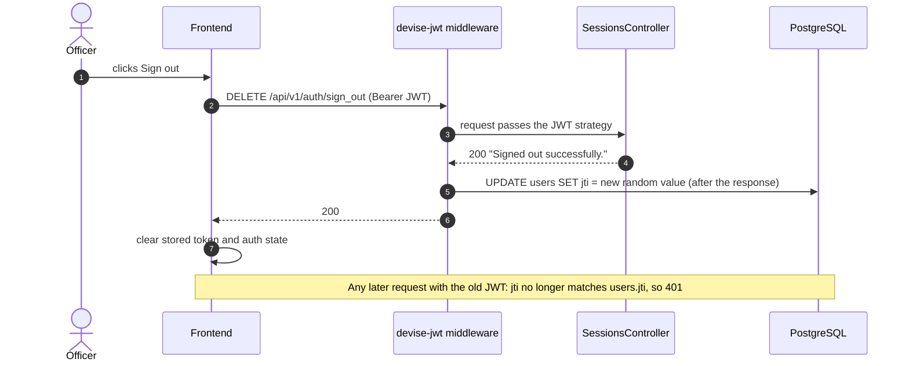

The controller never touches `jti`. devise-jwt's `RevocationManager` middleware does it once, because the route is in
`jwt.revocation_requests`. A test counts the `UPDATE ... "jti"` statements and asserts exactly one.

## 4.7 Admin deactivates an officer who is signed in

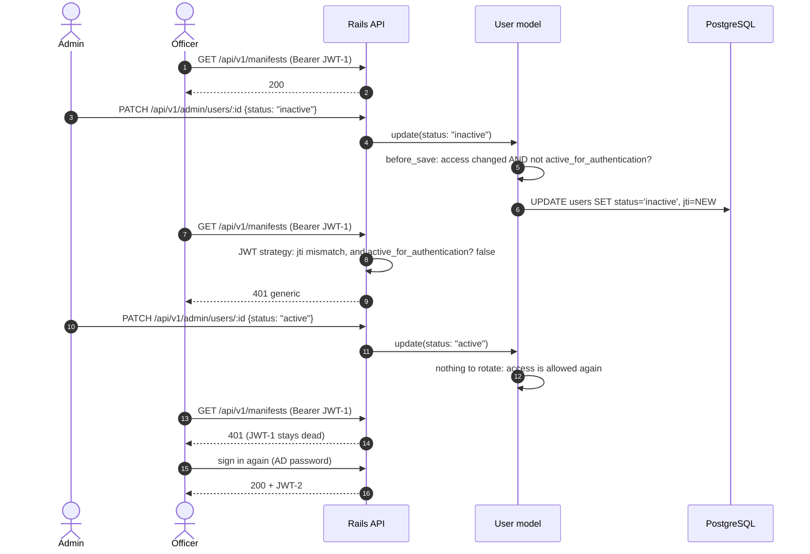

The same happens for the AASM events (`deactivate!`, `suspend!`, the Fisherman and Jetty Manager `.../deactivate`
endpoints) and for a soft delete (`discard`): the rule lives in the model callback, not in any one endpoint.

Two independent walls stop JWT-1: the changed `jti`, and `active_for_authentication?`. The `jti` change is what
keeps JWT-1 dead after reactivation.

## 4.8 Admin changes a username

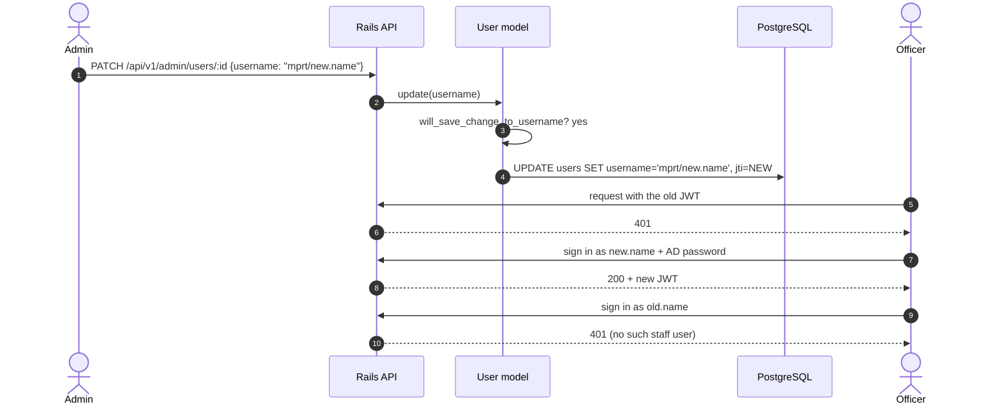

A name, phone, position, unit, email or locale change fires **no** rotation, so those edits never log anyone out.

## 4.9 Boot-time guard

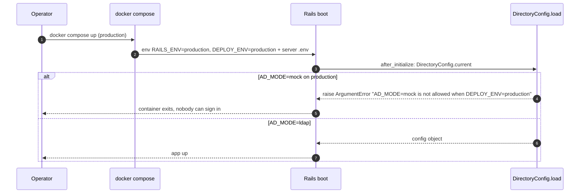

## 4.10 Production cut-over for the superadmin

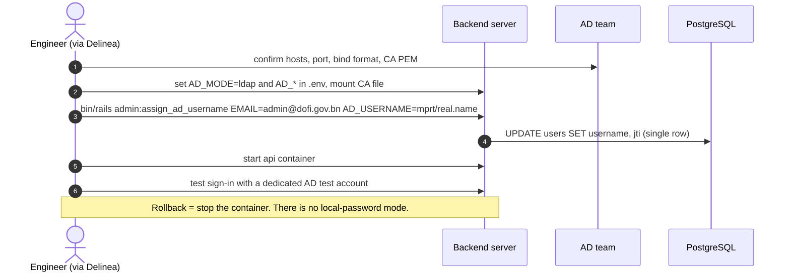

## 4.11 Fresh database seeding

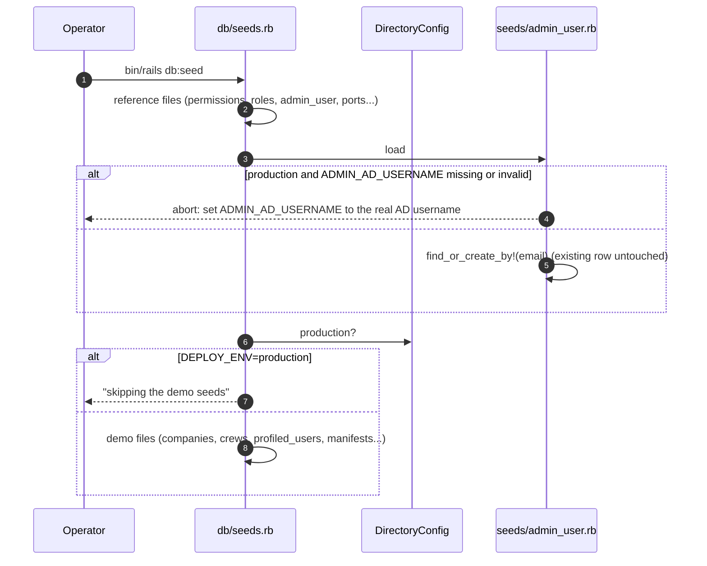
