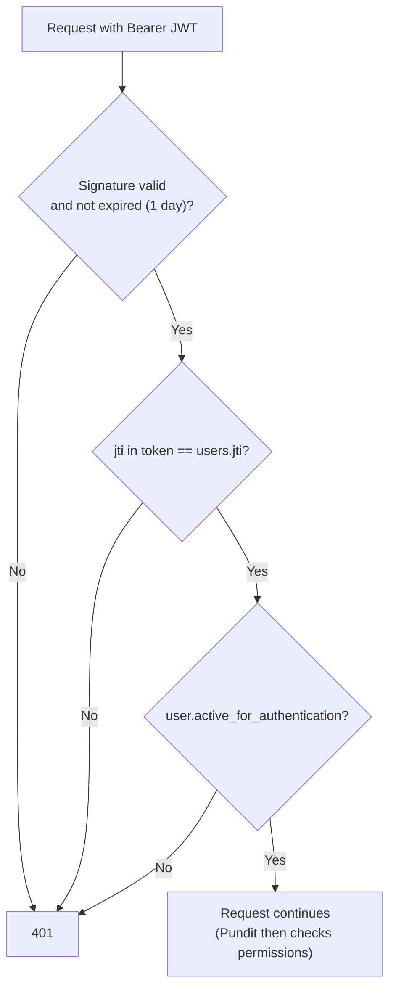
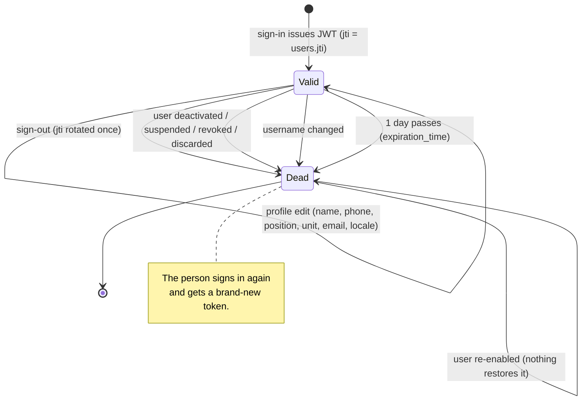

# 5. Token revocation and security

## 5.1 How a JWT is checked

After sign-in the frontend sends `Authorization: Bearer <JWT>` on every request. The JWT payload contains, among other
things, a `jti` ("JWT id"). devise-jwt's **JTIMatcher** strategy (already in `User`) accepts the token only if

```
token.jti  ==  users.jti   (the current value in the database)
```

So **changing `users.jti` kills every token issued before**, instantly, with no token list, cache or blacklist table.
All revocation in this system is "replace `users.jti`". The realtime (WebSocket) token embeds the same `jti` and is
re-checked against it, so it dies together with the JWT.



## 5.2 Token lifecycle



## 5.3 What rotates `jti`, and what does not

| Event | Rotates `jti`? | Mechanism |
|---|---|---|
| Sign-out (`DELETE /api/v1/auth/sign_out`) | Yes, **once** | devise-jwt `RevocationManager` (route in `jwt.revocation_requests`) |
| Status becomes `inactive`, `suspended` | Yes | `before_save :revoke_tokens` |
| Fisherman status becomes `suspended`, `revoked` | Yes | same callback (`fisherman_status`) |
| User is discarded (soft delete) | Yes | same callback (`discarded_at`) |
| `username` changes | Yes | same callback (identity changed) |
| User is **re-enabled** (reactivate, undiscard) | **No** | the token was already killed at deactivation; nothing brings it back |
| Name, phone, position, unit, email, locale change | **No** | not an access or identity change |
| Saving the same status or username again | **No** | `will_save_change_to_*` is false |
| User is created | No | `JTIMatcher` sets the first `jti` itself |

### The code

```ruby
# app/models/user.rb
ACCESS_DENIED_STATUSES = %w[inactive suspended revoked].freeze

before_save :revoke_tokens, if: :token_revocation_needed?

def active_for_authentication? = super && kept? && ACCESS_DENIED_STATUSES.exclude?(lifecycle_status)
def inactive_message = :invalid

def lifecycle_status
  fisherman? && fisherman_status.present? ? fisherman_status : status
end

private

def revoke_tokens = self.jti = self.class.generate_jti

def token_revocation_needed?
  return false if new_record?

  username_changed = will_save_change_to_username?
  access_changed = will_save_change_to_status? || will_save_change_to_fisherman_status? ||
                   will_save_change_to_discarded_at?
  username_changed || (access_changed && !active_for_authentication?)
end
```

Reading it:

- `lifecycle_status` picks the status that matters for the user kind: a Fisherman's `fisherman_status`, everyone else's
  `status`. One predicate therefore covers staff, Jetty Managers and Fishermen.
- A `claimable` Fisherman (not yet claimed) is **not** in `ACCESS_DENIED_STATUSES`, so the existing claim flow is
  untouched.
- `token_revocation_needed?` is evaluated in a `before_save`, so `jti` changes **in the same UPDATE** as the status.
  There is no window where the user is deactivated but the old token still works.
- `access_changed && !active_for_authentication?` means "something about access changed **and** the user is now denied".
  Re-enabling changes the status but leaves the user allowed, so it is skipped.
- `generate_jti` is JTIMatcher's own generator (`SecureRandom.uuid`). Nothing new was introduced.

### Two walls

A deactivated user's old token meets **two independent** checks:

1. `users.jti` was replaced, so the JWT no longer matches.
2. `active_for_authentication?` is false, so even a token that still matched would be refused.

The first is what keeps the token dead **after** reactivation (the second no longer applies then). The second protects
cases where a status changes by a path that bypasses callbacks (e.g. raw SQL `update_all`), for as long as the status is
denied. Know the limit: **raw SQL that skips callbacks does not rotate `jti`**. No code in this repo does that for these
columns, and a test mutation check showed removing either wall breaks tests.

## 5.4 Why Devise's `active_for_authentication?` covers JWT requests

Devise registers an `after_set_user` Warden hook ("activatable"). Warden fires it every time a user is set for a
request: sign-in **and** each JWT-authenticated request. The hook calls `user.active_for_authentication?`; when false it
throws `:warden` with the `inactive_message`. By overriding that single predicate, one change protects every protected
endpoint, including `/auth/me`, without touching any controller.

`inactive_message` returns `:invalid`, so a refused user receives the same generic 401 body as a wrong password. The
person is not told "your account is disabled", and nobody can probe which accounts are disabled.

## 5.5 Security properties and where they are enforced

| Property | Enforced by | Tested in |
|---|---|---|
| Plaintext LDAP is never used | `encryption: { method: :simple_tls }`; port 389 rejected by `DirectoryConfig#problems` | `ldap_authenticator_tls_test`, `directory_config_test` |
| Server certificate is verified | `verify_mode: VERIFY_PEER`, TLS 1.2+ | `ldap_authenticator_tls_test` |
| Host name must match the certificate | DNS names only (IPs rejected); net-ldap host check | `directory_config_test` |
| Empty password never reaches AD (unauthenticated bind) | `LdapAuthenticator#usable?` | `ldap_authenticator_test` |
| Bind name cannot be injected | `SHORT_NAME` allow-list; identity built from the **stored** username | `directory_username_test`, `officer_login_test` |
| Control characters / NUL rejected | `DirectoryUsername#control_characters?` | `directory_username_test` |
| Wrong password not replayed over every DC | net-ldap fails over only on connect/TLS errors (library behaviour; `LdapAuthenticator` makes a single bind attempt) | not separately tested |
| No account enumeration | identical 401 body for every refusal | `sessions_active_directory_refusals_test` |
| No local password for staff | `valid_password?` is false; strategy ordering | `user_directory_test`, `sessions_controller_test` |
| Mock cannot run on production | boot `ArgumentError`; compose `DEPLOY_ENV` pinned | `directory_config_test`, `deployment_environment_test` |
| Mock password never committed | scan of committed files for `AD_MOCK_PASSWORD=value` | `deployment_environment_test` |
| Mock password not stored as a user password | create-user test checks `valid_password?` | `sessions_shared_mock_password_test` |
| Constant-time password compare (mock) | `ActiveSupport::SecurityUtils.secure_compare` | shared authenticator contract (correct/wrong password) |
| No secrets in logs | only mode, outcome, reason, user id, duration; exception class only | `officer_login_test`, `ldap_authenticator_test` |
| Production has no known-password demo accounts | `db/seeds.rb` skips demo files | `demo_seeds_production_guard_test` |
| Production never bootstraps a placeholder superadmin | seed aborts without `ADMIN_AD_USERNAME` | `admin_user_seed_test` |
| Deactivated users lose access immediately | `active_for_authentication?` + `revoke_tokens` | `sessions_token_revocation_test`, `user_token_revocation_test` |
| Re-enabling does not revive tokens | no rotation back; jti stays changed | `sessions_token_revocation_test` |

## 5.6 Threats considered

| Threat | Mitigation | Residual risk |
|---|---|---|
| Someone sets `AD_MODE=mock` on production | Boot refuses; compose pins `DEPLOY_ENV=production`; a test pins the compose files | An attacker with edit rights on the compose file could change it, which is already full compromise |
| Typo in `AD_MODE` | Unknown values raise at boot (no `disabled`, no default under production) | None |
| Sign in with an empty password | Rejected before any bind | None |
| LDAP injection via the username | Allow-list regex; the bind name is built from the matched row | None known |
| Man-in-the-middle on the AD link | LDAPS + `VERIFY_PEER` + host name check + private CA | Depends on the CA file being the right one |
| Brute force / AD lockout of a victim | 10 sign-ins/min/IP | **No per-username throttle** (open item) |
| Stolen token after the person is fired | Deactivation rotates `jti` at once; tokens also expire after 1 day | None for DoFi-side deactivation; an **AD-side** disable is only seen at the next sign-in |
| Shared mock password leaks | Never committed; set per environment in `.env` | Anyone who knows it can sign in as any staff user in that environment (staging). Keep it out of chat and the repo. |
| AD outage locks every officer out | No bypass by design; runbook has a controlled server procedure | Needs the client's decision if they want an in-app break-glass account |
| A staff row is renamed to a colliding name | Rake task refuses duplicates; ambiguous matches sign nobody in | None |
| Demo accounts with `ChangeMe123!` on production | Demo seeds skipped when `DEPLOY_ENV=production` | Rows seeded **earlier** stay until removed (cut-over step) |

## 5.7 Behaviour you should know about

- **One `jti` per user.** Signing out on one device signs the user out everywhere. This is JTIMatcher's design and was
  already true before AD.
- **Tokens last one day** (`jwt.expiration_time`). Revocation is what makes "sign-out" and "deactivate" immediate before
  that.
- **AD-side changes are invisible until the next sign-in.** Disabling a person in AD does not kill a DoFi token that is
  already issued; deactivate the DoFi user (or wait for expiry) for immediate effect.
- **A 401 for an authenticated call always means "the token is no longer good".** The frontend should clear the token and
  show the sign-in page, whether the cause was sign-out, deactivation, a username change or expiry.
