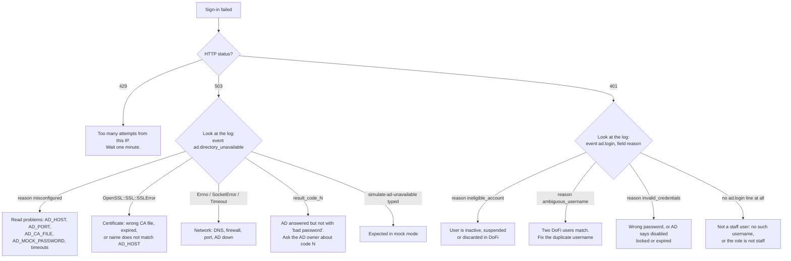

# 6. Testing, recipes and troubleshooting

## 6.1 Running the tests

Docker (the normal way in this repo):

```bash
docker compose exec api bin/rails test                                        # whole suite
docker compose exec api bin/rails test test/services/authentication           # the AD unit tests
docker compose exec api bin/rails test test/controllers/api/v1/sessions_token_revocation_test.rb
docker compose exec api bin/rails test test/controllers/api/v1/sessions_token_revocation_test.rb:29   # one test by line
```

Quality gates (the repository's definition of done): `bin/rubocop`, `bin/rbac-lint`, `bin/rails test`, `bin/brakeman`,
`bin/bundler-audit`. `bin/ci` runs them all.

`test_helper.rb` sets `AD_MODE=mock`, `AD_MOCK_PASSWORD=mock-ad-password` and `DEPLOY_ENV=test` for every test, and
`auth_headers_for(user)` signs staff in with the mock password and everyone else with the password you give it. That is
why ~90 older tests needed no change.

## 6.2 Test map

| What you want to understand | Read this test |
|---|---|
| Boot guard table (mock on production, missing DEPLOY_ENV, unknown mode...) | `test/services/authentication/directory_config_test.rb` |
| Username spellings and what is rejected | `test/services/authentication/directory_username_test.rb` |
| Real LDAPS behaviour with a fake server object (bind identity, TLS options, result codes, timeouts) | `test/services/authentication/ldap_authenticator_test.rb` |
| TLS verification against a **real local TLS server** (good CA, wrong CA, wrong host name) | `test/services/authentication/ldap_authenticator_tls_test.rb` |
| Mock behaviour | `test/services/authentication/mock_ldap_authenticator_test.rb` |
| The decision logic: staff lookup, eligibility, ambiguity, logging | `test/services/authentication/officer_login_test.rb` |
| Who counts as staff | `test/models/role_directory_managed_test.rb`, `test/models/user_directory_test.rb` |
| End-to-end sign-in over HTTP | `test/controllers/api/v1/sessions_active_directory_test.rb` |
| Refusals: 401 vs 503, enumeration, Fisherman/Jetty Manager unchanged | `.../sessions_active_directory_refusals_test.rb` |
| Shared mock password rules | `.../sessions_shared_mock_password_test.rb` |
| Token revocation over HTTP | `.../sessions_token_revocation_test.rb` |
| Token revocation at model level (what rotates, what does not) | `test/models/user_token_revocation_test.rb` |
| Superadmin seed | `test/db/admin_user_seed_test.rb` |
| No demo accounts in production | `test/db/demo_seeds_production_guard_test.rb` |
| Rake remap task | `test/lib/admin_rake_test.rb` |
| Compose files carry the right `DEPLOY_ENV`, no committed mock password | `test/config/deployment_environment_test.rb` |

### Test helpers (`test/support/`)

| File | Purpose |
|---|---|
| `directory_test_support.rb` | Build a `DirectoryConfig` without touching `ENV` (`mock_directory_config`, `production_directory_config`, ...); `with_directory_config` makes the whole app see a config; `with_ldap_result` stands in for AD; `with_env` sets and restores real `ENV` variables |
| `directory_accounts_support.rb` | Creates a staff user, a Jetty Manager and a Fisherman; `sign_in_as(username, password)` returns the HTTP status |
| `directory_authenticator_contract.rb` | The assertions both authenticators must satisfy |
| `fake_ldap.rb` | A stand-in for `Net::LDAP` that records how it was built and returns a chosen result |

Minitest 6 (used here) has no `.stub`; helpers use `define_singleton_method` and restore the original in an `ensure`.

### Pattern: test through the public interface

Most tests drive `POST /api/v1/auth/sign_in` or call a service's `call`, never private methods. When you change
internals, tests should still pass; when you change behaviour, the matching test should fail. We checked this with
mutation runs (deleting the `revoke_tokens` callback or the `active_for_authentication?` override each broke 8 tests).

## 6.3 Recipes

### Sign in locally as a staff user

```bash
# .env (not committed): set AD_MODE=mock, and give AD_MOCK_PASSWORD a value of your own choosing.
# Never write a real value into a committed file; a test fails if one appears.
AD_MODE=mock
```

```bash
docker compose restart api          # env changes need a restart
docker compose exec api bin/rails db:seed
curl -s -X POST localhost:3000/api/v1/auth/sign_in -H 'Content-Type: application/json' \
  -d "{\"user\":{\"username\":\"mprt/dof-001\",\"password\":\"$YOUR_MOCK_PASSWORD\"}}"
```

The seeded superadmin is `mprt/dof-001` (`admin@dofi.gov.bn`). The old `ChangeMe123!` no longer works for staff.

### Add a new officer

User Management → Add User, **no password**, username `mprt/<ad name>` (lowercase). Then they sign in with the AD
password (production) or the environment's `AD_MOCK_PASSWORD` (local, staging).

### Simulate "AD is down" for the frontend

Sign in as any staff user with the password `simulate-ad-unavailable` (mock mode only). Expect HTTP 503 and the message
"Sign-in is temporarily unavailable. Please try again later."

### Remap the superadmin to a real AD name

```bash
docker compose run --rm api bin/rails admin:assign_ad_username EMAIL=admin@dofi.gov.bn AD_USERNAME=mprt/real.name
```

### Check the real AD from the container (production, staging with `ldap`)

```bash
openssl s_client -connect <AD_HOST>:<AD_PORT> -servername <AD_HOST> -CAfile /etc/dofi/ad-ca.pem </dev/null | head -20
```

Do **not** repeat wrong passwords against real accounts: AD locks them.

### Add a new setting

1. Add the key to `DirectoryConfig` (`connection_settings` / `identity_settings`), including a `problems` entry if a bad
   value makes the directory unusable.
2. Add it to both `.env.example` files (leave secrets empty).
3. Add a row to the configuration table in the runbook.
4. Add a case to `directory_config_test.rb`.

### Add a third kind of directory (for example another IdP)

Create a class with `call(username:, password:)` returning `Success(:authenticated)`, `Failure(:invalid_credentials)` or
`Failure(:directory_unavailable)`, include `DirectoryAuthenticatorContract` in its test, and select it in
`OfficerLogin#initialize`. Nothing else changes.

## 6.4 Troubleshooting

### Decision tree: the user cannot sign in



Find the lines with `docker compose logs api | grep ad\\.`. Each is JSON: `event`, `level`, `user_id`, `params.mode`,
`params.outcome`, `params.reason`, `params.duration_ms`.

### Common symptoms

| Symptom | Likely cause | Fix |
|---|---|---|
| App exits at start with `AD_MODE must be one of: mock, ldap` | `AD_MODE` missing in `.env` under `RAILS_ENV=production`, or set to anything other than `mock` or `ldap` | Set `AD_MODE` |
| App exits with `DEPLOY_ENV must be one of: staging, production` | Compose file lacks `DEPLOY_ENV` | Use the repo's compose file; do not delete the line |
| App exits with `AD_MODE=mock is not allowed when DEPLOY_ENV=production` | The guard working | Set `AD_MODE=ldap` |
| Every staff sign-in is 503 locally | `AD_MOCK_PASSWORD` is empty in `.env` | Set it, restart `api` |
| Staff sign-in is 503 in production, log says `misconfigured` | Missing/invalid `AD_*` values | The log's `problems` array lists them |
| 503 with `OpenSSL::SSL::SSLError` | CA not trusted or certificate name mismatch | Check `AD_CA_FILE`, its mount, and that `AD_HOST` appears in the certificate SAN |
| 401 for a valid officer, log `ineligible_account` | User is `inactive`/`suspended`/discarded | Reactivate in User Management |
| 401 for a valid officer, no `ad.login` log | Username not found among staff (typo, wrong prefix, or the role is Jetty Manager / Fisherman) | Check the username is `mprt/<name>` and the role |
| 401 right after being admitted | The token was revoked (sign-out elsewhere, deactivation, username change) | Sign in again |
| Old superadmin `ChangeMe123!` fails | By design: staff have no local password | Use the mock/AD password |
| `admin:assign_ad_username` says "already belongs to another user" | Another row uses the name (or the same name without the prefix) | Resolve the duplicate first |
| Tests: 503 on every staff sign-in | `AD_MOCK_PASSWORD` unset in the test process | `test_helper` sets it; check you did not clear `ENV` |
| After editing an initializer or env | Stale process | `docker compose restart api` |

## 6.5 FAQ

**Why does the Add User form have no password field?** Staff never have a DoFi password. `User#password_required?` is
false for staff, so nothing is asked for, generated or stored; `encrypted_password` stays empty.

**Does AD create the DoFi user when someone signs in for the first time?** No. An admin creates the user first; AD only
checks the password.

**Can a Fisherman type a staff username?** The staff lookup only searches staff, so it returns nothing and the request
continues on the normal path. The mock password is not accepted for them either.

**What if two directory servers disagree?** They are the same AD forest. The first reachable host that answers decides;
the next is tried only when the previous one could not be reached.

**Why 1 day for the token?** Existing setting (`jwt.expiration_time`). Revocation makes sign-out and deactivation
immediate regardless.

**Why is staging `RAILS_ENV=production`?** It runs the production image to be as close as possible to production.
That is exactly why `DEPLOY_ENV` was added.

**Can I turn AD off to debug?** No. There is no off switch. Use `AD_MODE=mock` locally: it needs no AD server.

**Can I use `ADMIN_DEFAULT_PASSWORD` for the superadmin?** No longer. It only still affects the demo seeds for
Fisherman and Jetty Manager accounts outside production.

**What is not covered by automated tests?** The real Active Directory. Everything up to the LDAP socket is tested, TLS
verification is tested against a local TLS server, but a real bind against the government AD (host names, port 3269 vs
636, bind format `netbios` vs `upn`, the CA) can only be verified on the network that can reach it. See the cut-over
steps in the runbook.

## 6.6 Related documents

- Runbook, configuration table, cut-over and emergency procedure:
  [`docs/registration/active-directory-login.md`](../registration/active-directory-login.md)
- Open questions for the client:
  [`docs/registration/active-directory-integration-requirements.md`](../registration/active-directory-integration-requirements.md)
- How users are registered and the sign-in endpoints:
  [`docs/registration/business-flow.md`](../registration/business-flow.md),
  [`docs/api/endpoint-structure.md`](../api/endpoint-structure.md)
- Deployment: [`docs/ci-cd/PRODUCTION-DEPLOY-CHECKLIST.md`](../ci-cd/PRODUCTION-DEPLOY-CHECKLIST.md)
