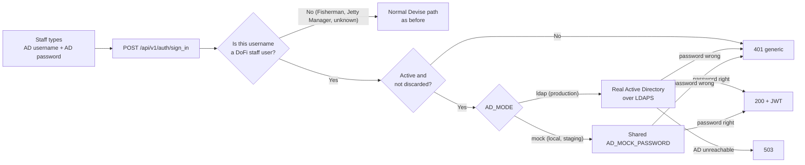

# Active Directory sign-in: learning guide

This folder explains how DoFi staff sign in with their **Active Directory (AD)** account, written for developers who
have never seen this code. Read it in order the first time; later, jump to the file you need.

> The operations runbook (environment variables, production cut-over, emergency access) is
> [`docs/registration/active-directory-login.md`](../registration/active-directory-login.md). This folder is the
> *why and how the code works* companion to it. The questions still open with the client are in
> [`active-directory-integration-requirements.md`](../registration/active-directory-integration-requirements.md).

## Reading order

| # | File | You will learn | Time |
|---|---|---|---|
| 1 | [01-business-context-and-features.md](01-business-context-and-features.md) | Why AD, who is "staff", the business rules and the feature list | 10 min |
| 2 | [02-architecture.md](02-architecture.md) | Architecture diagrams: components, layers, classes, environments, boot guard | 15 min |
| 3 | [03-code-walkthrough.md](03-code-walkthrough.md) | One sign-in followed line by line through every file | 25 min |
| 4 | [04-sequence-diagrams.md](04-sequence-diagrams.md) | Sequence diagrams for every scenario (success, wrong password, AD down, sign-out, deactivation...) | 15 min |
| 5 | [05-token-revocation-and-security.md](05-token-revocation-and-security.md) | How a JWT is killed, the security decisions and their reasons | 15 min |
| 6 | [06-testing-and-troubleshooting.md](06-testing-and-troubleshooting.md) | Test map, recipes ("how do I..."), debugging a 401 or a 503, FAQ | 15 min |

## The feature in one minute

Three sentences to remember:

1. **AD only answers one question: "is this password right for this account?"** Everything else (does the user exist,
   is the account active, what can they do) is decided by DoFi's own PostgreSQL data.
2. **Staff have no local password anywhere.** Not in production, not in staging, not on your laptop. Local and staging
   use a stand-in directory (`mock`) where everyone shares one password; production uses the real AD.
3. **The JWT, the response and the endpoint did not change.** `POST /api/v1/auth/sign_in` returns the same body as
   before, so the frontend contract is unchanged (it only has to treat 401 as "token dead" and 503 as "sign-in
   temporarily unavailable").

## Glossary

| Term | Meaning |
|---|---|
| **AD** | Active Directory: the government's central user directory. It stores each person's account and password. |
| **LDAP / LDAPS** | The protocol used to talk to AD. LDAPS is LDAP inside TLS (encrypted). We never use plain LDAP. |
| **Bind** | The LDAP operation "log in as this identity with this password". A successful bind means the password is right. |
| **sAMAccountName** | The short AD login name, e.g. `azri.nizam`. In the code it is called the *short name*. |
| **NetBIOS domain** | The short domain name, here `MPRT`. Used as `MPRT\azri.nizam` or as the `mprt/` prefix of stored usernames. |
| **Staff** | Internal DoFi users: any role on the DoFi Officer platform **except** Jetty Manager. Includes custom roles. Code name: *directory managed*. |
| **Mock** | `AD_MODE=mock`: a fake directory for local and staging. Every staff user shares one password, `AD_MOCK_PASSWORD`. |
| **Warden** | The Rack authentication framework underneath Devise. Devise runs a list of *strategies*; the first one that decides wins. |
| **Strategy** | A Warden class with an `authenticate!` method that can `success!`, `fail!`, `pass` or `custom!`. Ours is `ActiveDirectoryStrategy`. |
| **JWT** | The token returned at sign-in and sent on every later request (`Authorization: Bearer ...`). |
| **JTI** | The unique id inside the JWT. It must equal `users.jti`; changing `users.jti` invalidates every earlier token. |
| **JTIMatcher** | The devise-jwt module that implements the JTI check. We reuse it; there is no other revocation mechanism. |
| **DEPLOY_ENV** | Which deployment this is: `development`, `test`, `staging` or `production`. Needed because staging also runs `RAILS_ENV=production`. |
| **Fail closed** | When something is wrong or unknown, refuse (or return 503). Never fall back to a weaker path. |

## Where the code lives

| Area | Path |
|---|---|
| Settings and boot guards | [`app/services/authentication/directory_config.rb`](../../app/services/authentication/directory_config.rb) |
| Turning typed text into usernames | [`app/services/authentication/directory_username.rb`](../../app/services/authentication/directory_username.rb) |
| The sign-in decision | [`app/services/authentication/officer_login.rb`](../../app/services/authentication/officer_login.rb) |
| Real AD (LDAPS) | [`app/services/authentication/ldap_authenticator.rb`](../../app/services/authentication/ldap_authenticator.rb) |
| Fake AD (local, staging) | [`app/services/authentication/mock_ldap_authenticator.rb`](../../app/services/authentication/mock_ldap_authenticator.rb) |
| Warden glue | [`app/strategies/authentication/active_directory_strategy.rb`](../../app/strategies/authentication/active_directory_strategy.rb) |
| Registration + boot check | [`config/initializers/directory_authentication.rb`](../../config/initializers/directory_authentication.rb) |
| Strategy order | [`config/initializers/devise.rb`](../../config/initializers/devise.rb) (the `config.warden` block) |
| Who is staff | [`app/models/role.rb`](../../app/models/role.rb), [`app/models/user.rb`](../../app/models/user.rb) |
| Token revocation | [`app/models/user.rb`](../../app/models/user.rb) (`revoke_tokens`, `active_for_authentication?`) |
| Superadmin seed and remap task | [`db/seeds/admin_user.rb`](../../db/seeds/admin_user.rb), [`lib/tasks/admin.rake`](../../lib/tasks/admin.rake) |
| Demo-seed production guard | [`db/seeds.rb`](../../db/seeds.rb) |
| Tests | [`test/services/authentication/`](../../test/services/authentication), `test/controllers/api/v1/sessions_*`, `test/models/user_*`, `test/db/*seed*`, `test/config/deployment_environment_test.rb` |

> Diagrams use [Mermaid](https://mermaid.js.org/). GitHub, GitLab and the VS Code "Markdown Preview Mermaid Support"
> extension render them; in a plain text editor you will see the diagram source.
