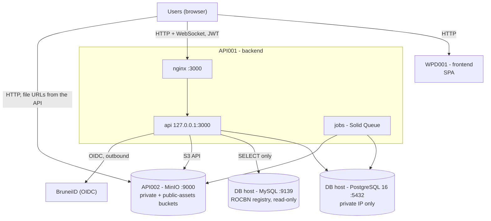

# Production architecture: 4 servers

> **Status: proposed 2026-10-19, servers not set up yet.** The backend and storage compose files and the database
> runbook are in [`deploy/`](../../deploy/README.md), and [`cd-production.yml`](../../.github/workflows/cd-production.yml)
> deploys the backend from them. What to do, in order: [`PRODUCTION-DEPLOY-CHECKLIST.md`](../ci-cd/PRODUCTION-DEPLOY-CHECKLIST.md).
> **First step: the firewall request in [§3](#3-network-firewall-request).**

The client provides five servers; we use four, **one role per server**. The scope is deliberately small: put the
stacks on the servers and reach them by IP over plain HTTP. There is no domain yet, so no TLS. The backend server runs
nginx on port 3000 (the port the client's firewall opens to the frontend) as its only public entry, with Rails on the loopback behind it
([runbook](../../deploy/production/backend/README.md)).

## 1. Servers

| Role | Host | IP | Runs | Files |
|---|---|---|---|---|
| Backend (App Server) | OGCMET001API001 | 10.252.8.12 | nginx (:3000 on 10.252.8.12, on the host) in front of Rails `api` (127.0.0.1:3000) and `jobs`, in Docker | [`deploy/production/backend/`](../../deploy/production/backend/) |
| File storage | OGCMET001API002 | 10.252.8.13 | MinIO (:9000), in Docker | [`deploy/production/storage/`](../../deploy/production/storage/) |
| Frontend (Web Server) | OGCMET001WPD001 | 10.246.8.12 | SPA (:4100), built and deployed by the frontend repo | frontend repo |
| Database | OGCMPT003API001 | 10.252.8.23 | PostgreSQL 16, native from Ubuntu's apt (:5432), no Docker | [`deploy/production/database/`](../../deploy/production/database/README.md) |

The database host also runs MySQL 8.0 for another system (port 9139). PostgreSQL is a separate package with its own
port (5432) and data directory, so it does not touch MySQL. The application connects to PostgreSQL as a dedicated
non-superuser role (`dofi`, `LOGIN CREATEDB`), only from the backend server. It also **reads** one table from that
MySQL, `tdd_db.sync_rocbn_hotel`, with an account that holds `SELECT` only, for the Add Profiling company lookup: see
[`docs/rocbn/company-lookup.md`](../rocbn/company-lookup.md). Docker on that host is a fallback only
([`deploy/production/database/docker/`](../../deploy/production/database/docker/)), if a native install is not allowed.

## 2. Topology

Browsers talk to MinIO directly because the app still hands out presigned file URLs (`302` redirects from
`/api/v1/attachments/...`); `MINIO_PUBLIC_ENDPOINT` is therefore the storage server's address.

## 3. Network (firewall request)

The rules to request from the client's network team. **Send this before anything is deployed:** the first
`db:prepare` needs the database port, the first boot needs MinIO, and `docker pull` needs outbound access to
`ghcr.io`, so a deploy cannot start without them.

| No | Source IP | Destination IP | Port | Remark |
|---|---|---|---|---|
| 1 | Users (client LAN/VPN range, TBC) | 10.246.8.12 | 4100 | Browser to Web Server (frontend) |
| 2 | 10.246.8.12 (Web Server) | 10.252.8.12 | 3000 | Web Server to App Server (the client's own rule; nginx listens here and forwards to Rails on the loopback; browsers never call the App Server directly) |
| 3 | Users (client LAN/VPN range, TBC) | 10.252.8.13 | 9000 | Browser to File Storage Server (MinIO file URLs) |
| 4 | 10.252.8.12 | 10.252.8.13 | 9000 | App Server to File Storage Server (uploads, S3 API) |
| 5 | 10.252.8.12 | 10.252.8.23 | 5432 | App Server to DB Server (PostgreSQL 16, App Server only) |
| 6 | 10.252.8.12 | BruneiID host (TBC) | 443 | App Server to BruneiID (OIDC login, outbound) |
| 7 | 10.252.8.12 | ghcr.io, pkg-containers.githubusercontent.com | 443 | App Server pulls the backend image (outbound; the second host serves the image layers) |
| 8 | 10.252.8.13 | ghcr.io | 443 | File Storage Server pulls the MinIO image (outbound) |
| 9 | 10.252.8.23 | archive.ubuntu.com, security.ubuntu.com (or the client's internal apt mirror) | 80/443 | DB Server installs and updates the `postgresql-16` package (outbound) |
| 10 | Admin / VPN / Delinea | 10.246.8.12, 10.252.8.12, 10.252.8.13, 10.252.8.23 | 22 | Operations access to all servers |
| 11 | 10.252.8.12 | Approach B hosts (list below) | 443 (80 for Debian) | **Precaution only:** build the image on the App Server if CI or ghcr.io is down; requested as a permanent whitelist so an urgent hotfix is not delayed |
| 12 | 10.252.8.12 | 10.252.8.23 | 9139 | App Server to the existing MySQL 8.0 on the DB host: read-only ROCBN company lookup (`tdd_db.sync_rocbn_hotel`), App Server only |

Notes:
- Rows 6 to 9 are hostnames, not fixed IPs. Please allow them by hostname (FQDN) or through the client's proxy.
- Row 9 is not needed if the client has an internal apt mirror, or installs the package another way.
- Row 11 (Approach B, requested by the client's team): `ssh.github.com` (git over SSH on 443), `github.com`, Docker Hub (`registry-1.docker.io`, `auth.docker.io`, `index.docker.io`, `production.cloudflare.docker.com`, the `docker-images-prod...r2.cloudflarestorage.com` host), Debian (`deb.debian.org`, `security.debian.org`, ports 80 and 443) and RubyGems (`rubygems.org`, `index.rubygems.org`, `api.rubygems.org`, `production.cf.rubygems.org`). This app has no Node dependencies and no gem from GitHub, so npm, Yarn, `nodejs.org` and the extra GitHub API/CDN hosts (`api.`, `codeload.`, `raw.`, `objects.`, `release-assets.`) are not needed. No inbound rule from GitHub is needed anywhere.
- Row 5: besides the network firewall, the database server accepts only the backend server (`pg_hba.conf`, and `ufw` if active).
- Row 12 is the only MySQL path: the application reads one registry table and writes nothing. Besides the firewall, the
  MySQL account must allow the backend server's address (`'<account>'@'10.252.8.12'`) and hold `SELECT` on
  `tdd_db.sync_rocbn_hotel` only. The application does not use LDAP/AD or port 3306 (they belonged to the previous
  servers). Existing rules for other systems on these hosts should stay as they are.
- **Superseded 2026-10-27: browsers may not connect to the File Storage server at all.** They reach only the Web server (Frontend), which proxies `/api` to the Back End; only the Back End talks to storage. Row 3 is therefore **not requested**, and the topology in §2 (browser to MinIO, "file URLs from the API") no longer applies: files are relayed through the API (`/api/v1/attachments/:signed_id`). See [`docs/minio/STORAGE-PROTOCOL-OPTIONS.md`](../minio/STORAGE-PROTOCOL-OPTIONS.md) and [`docs/minio/UPLOAD-REGRESSION-2026-10-27.md`](../minio/UPLOAD-REGRESSION-2026-10-27.md).
- **Update 2026-10-27: Web to App on `3000` is the port in use, and it works** (`curl http://10.252.8.12:3000/up` from the Web server returns 200, CORS preflight and the `/cable` WebSocket handshake pass). Two things had to be fixed on the App server itself, neither on the client's network: nginx now listens on `10.252.8.12:3000` only, and the host's **`firewalld`** (zone `public`, which allowed only ssh and a few agent ports) got a rich rule allowing `10.246.8.12` to port 3000. The earlier "No route to host" / "Couldn't connect" was `firewalld` answering `ICMP admin prohibited`, seen with `tcpdump` on the App server; see the [runbook, step 6](../../deploy/production/backend/README.md#6-host-firewall). nginx does not listen on port 80 any more, and it is not requested from the client.
- **Update 2026-10-30: the Web server's own nginx must also allow 12 MB uploads.** Browsers call `/api` on the Frontend origin (`http://10.246.8.12:4100/api/...`), so a vessel-image or document upload passes the Frontend's nginx before the App Server's. Nginx's default `client_max_body_size` is 1 MB, and it answered `413 Request Entity Too Large` to vessel-image uploads (the App Server's nginx already allows 12 MB). The `/api` proxy block on the Web server needs `client_max_body_size 12m;`, the same value as the App Server and for the same reason (4 images of 2 MB, or one 10 MB PDF). That file lives in the frontend repo and on the Web server, not here.
- No TLS yet (no domain), so ports 4100, 3000 and 9000 are plain HTTP. With a domain, 443 is added on the App Server.
- **Status 2026-10-27, against the client's own table** (browser to web 4100, web to app 3000, app to DB 5432, app to storage 9000, app to AD 3268/3269 x3). Open and proven from the backend: rows 4, 5, 7. Still to request: row 12 (`9139`, refused), the user-facing rows 2 and 3 (browser to `80` and to `9000`; MinIO's console port `9001` is not published and is **not** needed), and row 6 once the BruneiID host is known. The client's "web to app `3000`" does not fit this design (`3000` is loopback only behind nginx): it is set aside for now, and needed again (as `80`) only if the web server proxies the API instead of the browser calling it directly (to confirm with the frontend team). Requested first: row 12 (`9139`) and browser to storage `9000`; the nginx alternative for files is in [`docs/minio/FILE-ACCESS-SEQUENCE.md`](../minio/FILE-ACCESS-SEQUENCE.md). The AD rows (3268/3269) are not used by this application.

## 4. Deploy

Order: database, then storage (`mc-init` creates the buckets), then backend (its first `db:prepare` creates the four
databases and seeds reference data, including images, so the first two must be up). Exact steps and `.env` values are
in [`deploy/README.md`](../../deploy/README.md).

Release flow (the client's "Approach A"): CI builds, humans pull. `cd-production.yml` tests the code, builds the image
and pushes `:<git sha>` and `:production` to GHCR; it never connects to the servers (the client's network has no
inbound path from GitHub, and the SSH deploy job is switched off). An engineer, in a Delinea session on the backend
server, then runs `docker compose pull`, `run --rm api bin/rails db:prepare`, `up -d`. A release restarts `api` for a
few seconds. Rollback: set `IMAGE_TAG` in the server's `.env` to a previous SHA and `up -d` again. The compose file,
`.env` and the nginx vhost are updated by hand. Fallback ("Approach B"): build the image on the server from a git
clone, using [`docker-compose.build.yml`](../../deploy/production/backend/docker-compose.build.yml)
([runbook section 11](../../deploy/production/backend/README.md#11-fallback-build-on-the-server-approach-b)).

## 5. Known limits (accepted for now)

| Limit | Consequence |
|---|---|
| No TLS | Passwords, JWTs and personal data cross the network in clear |
| One database, one MinIO, one backend, no replicas | Any of them down means that part is down; a release causes a short API restart |
| No backups configured | A nightly `pg_dump` copied off the server is the minimum before go-live |
| Ports 4100, 3000 and 9000 open | Needed until a domain and proxy exist (the App Server already has nginx; the frontend and MinIO ports are served directly) |

## 6. Later

1. A domain per public entry and certificates: HTTPS on the App Server's existing nginx, a proxy in front of MinIO, then `FORCE_SSL=true`.
2. A single private bucket (planned in `docs/minio/PLAN-SINGLE-PRIVATE-BUCKET.md`, not yet committed to this repo): Rails relays files, so MinIO no longer needs to be reachable by browsers.
3. Backups copied off-host and a restore drill; TLS between servers; a second `api` replica for zero-downtime releases.

## 7. Questions for the client

1. **Web and App IPs:** the server table says 10.246.8.12 and 10.252.8.12, but the previous firewall table used 10.246.8.11 and 10.252.8.11. Which is right?
2. Working `sudo` on the database host (`localadmin`), and approval to install the `postgresql-16` package there. Port 9139 is the existing MySQL that holds the ROCBN registry (row 12): which account may the backend server (10.252.8.12) use, is it limited to `SELECT` on `tdd_db.sync_rocbn_hotel`, and which authentication plugin does it use?
3. The users' source range (LAN/VPN) for port 4100, and the BruneiID hostname. Web to App uses port 3000 (see the "Port choice" note in the [backend runbook](../../deploy/production/backend/README.md).
4. CPU, RAM and disk per server, and where backups may be copied.
5. The whitelist the client's team sent covers the App Server only: does the database server also get outbound access for `apt` (row 9), and the storage server for `ghcr.io` (row 8)?
