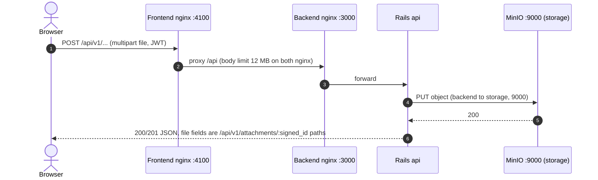
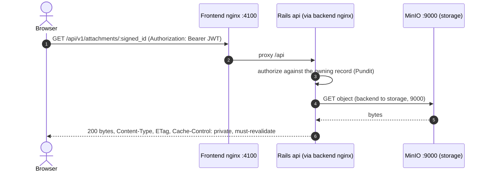

# Who talks to storage, and over which port

How files move between the browser and the object storage (MinIO), in the shape the client's network requires:
**browsers never connect to the storage server.** Files travel through the backend in both directions.

- Upload: FE -> BE -> MinIO.
- Download: MinIO -> BE -> FE.

> Superseded 2026-10-27: the earlier designs (a `302` to a presigned MinIO URL, and nginx proxying the bucket paths so
> the browser could reach MinIO through the backend's address) needed the browser to reach storage, directly or
> through a proxy. They are kept only as the decision record in
> [`STORAGE-PROTOCOL-OPTIONS.md`](STORAGE-PROTOCOL-OPTIONS.md) and
> [`ROUTE-FILES-THROUGH-APP-SERVER.md`](ROUTE-FILES-THROUGH-APP-SERVER.md). The current design and its rollout
> checklist are in [`PLAN-SINGLE-PRIVATE-BUCKET.md`](PLAN-SINGLE-PRIVATE-BUCKET.md).

Servers (production): frontend `10.246.8.12` (nginx `:4100`, proxies `/api`), backend `10.252.8.12` (nginx `:3000`,
Rails on loopback), storage `10.252.8.13` (MinIO `:9000`). The browser only ever talks to the frontend.

## 1. Upload

There is no direct upload (`config.active_storage.draw_routes = false` in production). The browser sends the file to
the API and Rails writes it to MinIO.



## 2. Download

Rails authorizes the request, reads the object from MinIO itself and answers with the bytes. It never redirects and
never hands out a storage URL.



A revisit sends `If-None-Match: <ETag>` and gets a bodyless `304`, but only after the authorization check passed.

## What the frontend must do

JSON never contains a storage URL. File fields are **relative API paths**: `image_url` (Dictionary),
`images.front|back|left|right.url` (vessel, on the company vessels and on the Profiling Approval responses),
`document_url` (company documents).

`` cannot send the JWT, so a path used that way fails (`401`, or the SPA's `index.html` because the path
resolves against the frontend origin). Fetch it with the `Authorization` header and show the result:

```js
const res = await fetch(path, { headers: { Authorization: `Bearer ${jwt}` } });
if (res.ok) img.src = URL.createObjectURL(await res.blob());
```

| Answer | Meaning |
|---|---|
| `200` | bytes (inline; `?disposition=attachment` for a download) |
| `304` | the cached copy is still valid |
| `401` | no or revoked JWT |
| `403` | the user may not see the owning record (see below) |
| `404` | bad/expired `signed_id`, or the object is missing from storage |
| `503` | storage server unreachable or failing; retry later |

## Who may fetch which file

The file is authorized by the **record that owns it**, not by the screen showing it
(`AttachmentsController::POLICY_CLASS_BY_RECORD_TYPE`):

| File | Needs |
|---|---|
| Dictionary image | `dictionaries.view` (fishermen: always) |
| Vessel image, company document | `company_profiles.view`; a fisherman only for their own company |

So the Profiling Approval screens list the pictures with `companies_vessel_approvals.*`, but the bytes also need
`company_profiles.view` (the seeded "DoFi Officer" role has every permission). A role with `dictionaries.list` but no
`dictionaries.view` sees `image_url` in the list and is refused the picture. Policies do not accept another resource's
code as a fallback (see the RBAC contract in `CLAUDE.md`), so give the role the permission instead.

## Firewall rows this needs

| Path | Needed |
|---|---|
| Users' browsers -> frontend `4100` | yes |
| Frontend -> backend `3000` | yes |
| Backend -> storage `9000` | yes |
| Users' browsers -> storage `9000` | **no** |

## How this is kept true

- `test/architecture/files_served_only_through_relay_test.rb`: no app code builds a storage URL, production closes
  Active Storage's own routes, and every model that attaches files has a policy the relay can authorize with.
- `test/controllers/api/v1/upload_round_trip_test.rb` and `attachments_relay_test.rb`: upload, then fetch the same
  bytes back; no response carries a storage URL; a storage outage answers `503`.
- `script/smoke_file_relay.sh BASE_URL FISHERMAN_JWT [OFFICER_JWT]`: the same round trip against a real deployment,
  through the frontend proxy, with sha256 comparison.
- Real-MinIO local run of the production image: checklist item 7.3 in
  [`PLAN-SINGLE-PRIVATE-BUCKET.md`](PLAN-SINGLE-PRIVATE-BUCKET.md).
