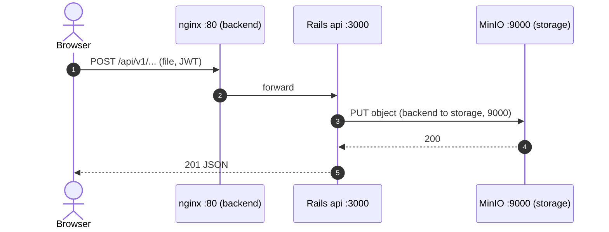
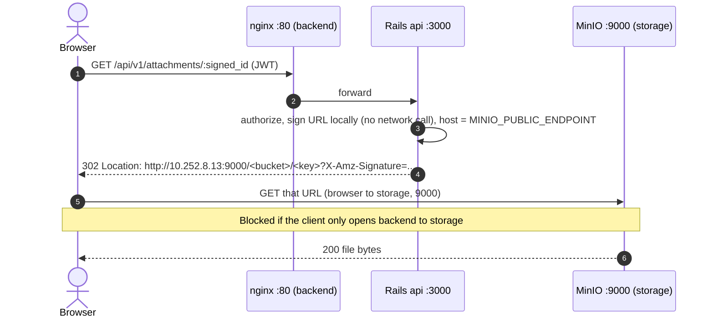
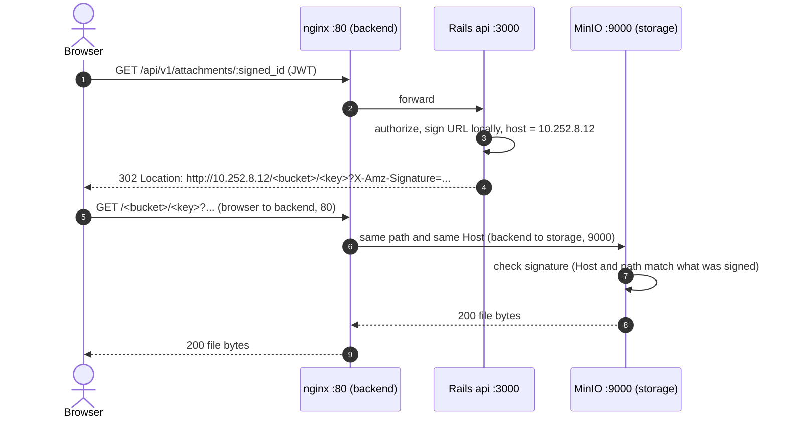

# Who talks to MinIO, and over which port

Why the browser needs a path to MinIO, and the two ways to give it one with the client's firewall (production, plain HTTP, no domain).
Servers: backend `10.252.8.12` (nginx :80, Rails :3000 on loopback), storage `10.252.8.13` (MinIO :9000), users' browsers on the client LAN/VPN.

## 1. Upload (works today, needs only backend to storage 9000)

The app has no direct upload: the browser sends the file to Rails, and Rails writes it to MinIO.

## 2. Download a private file, today (needs the browser to reach MinIO :9000)

Rails never streams the file. It answers with a redirect to a **presigned URL**, and the browser fetches the bytes itself.

Public images are the same without steps 1 to 3: the JSON already carries `http://10.252.8.13:9000/<public-bucket>/<key>`, and the browser fetches it from MinIO.

## 3. Download a private file, with nginx as the door (proposed; needs only browser to backend :80)

`MINIO_PUBLIC_ENDPOINT=http://10.252.8.12` (no port). nginx forwards the two bucket paths to MinIO, unchanged, with the original `Host`.

Why the path must not change: the signature covers the `Host` and the path. If nginx added or stripped a prefix such as `/minio/`, MinIO would see a different path than the one signed and answer `SignatureDoesNotMatch`. The bucket names (`dofi-production-private`, `dofi-production-public`) do not collide with any API route, so each gets its own `location` and is proxied as is.

## Firewall rows each option needs

| Option | Users to backend 80 | Users to storage 9000 | Backend to storage 9000 |
|---|---|---|---|
| Today (diagram 2) | yes | **yes** | yes |
| nginx as the door (diagram 3) | yes | no | yes |

Status: diagram 3 is a proposal, not yet applied or tested on the servers. The full analysis (architecture, the
signature trap, proposed nginx block, pros and cons, test plan) is in [`ROUTE-FILES-THROUGH-APP-SERVER.md`](ROUTE-FILES-THROUGH-APP-SERVER.md).
