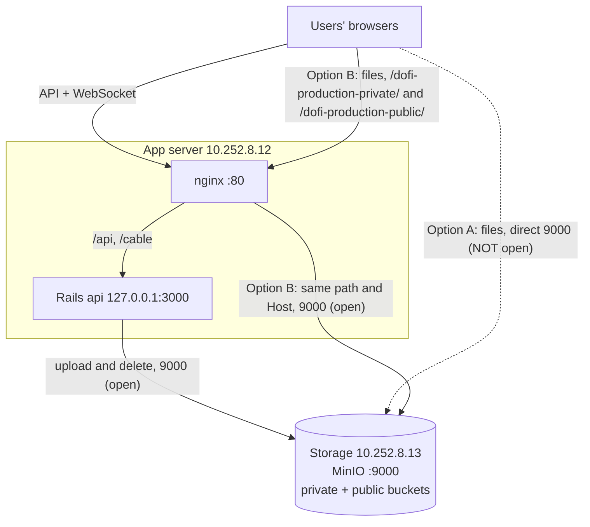
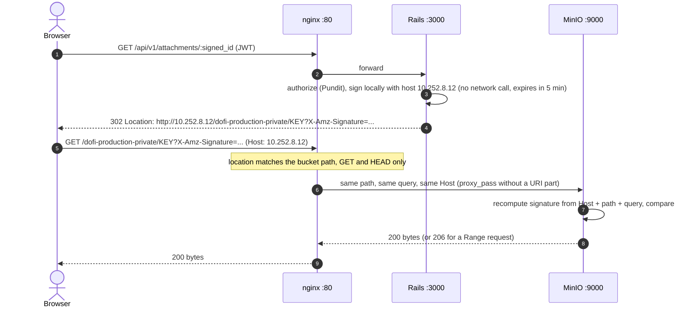
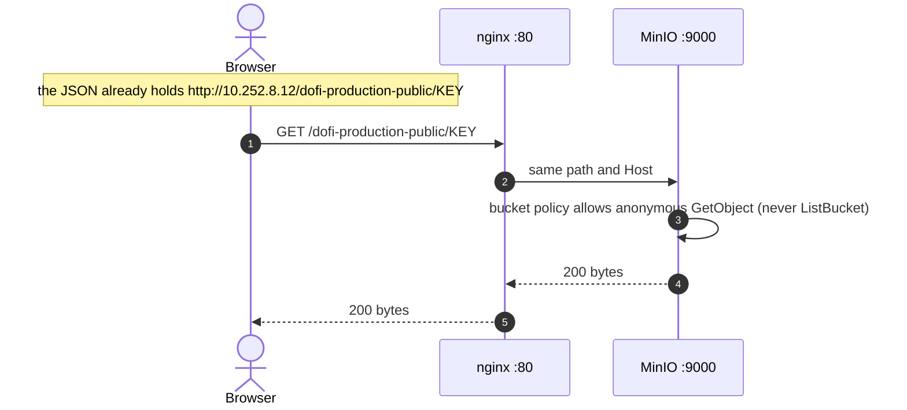
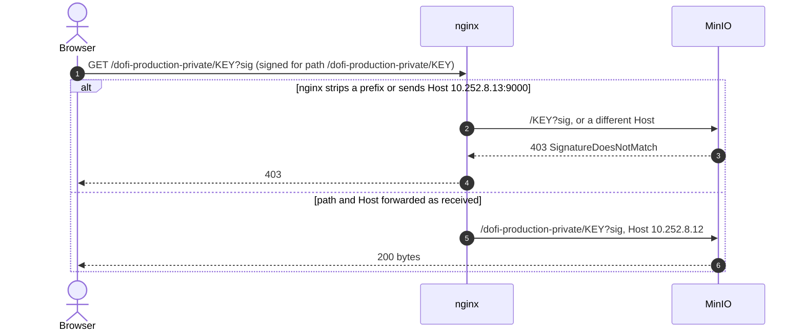

# Option: route file viewing through the App server (port 80)

> **Not chosen (2026-10-27).** The Front End server also may not reach storage and users reach only the FE, so a URL pointing at the BE's nginx would not work for them either; the relay in Rails replaced this option ([`STORAGE-PROTOCOL-OPTIONS.md`](STORAGE-PROTOCOL-OPTIONS.md)). Kept as analysis.
>
> *Original status:* analysis only, 2026-10-27. Nothing here is applied or tested on the servers. Written for the first
> acceptance-testing round, while the client has opened only App to File Storage (`9000`) and has not given a domain yet.
> Companion to [`FILE-ACCESS-SEQUENCE.md`](FILE-ACCESS-SEQUENCE.md) (the sequences in short) and
> [`MINIO-PUBLIC-PROXY-SETUP.md`](MINIO-PUBLIC-PROXY-SETUP.md) (the same idea on staging, with a proxy on its own port).

## 1. The problem in one paragraph

Rails never streams a stored file to the browser. For a private file it answers `302` with a **presigned URL**
(`Api::V1::AttachmentsController#show`, `Attachments::PublicUrl`), and for a public image the JSON already carries a plain
object URL (`Attachments::AssetUrl`). Both URLs are built from `MINIO_PUBLIC_ENDPOINT`, and the **browser** then fetches the
bytes. With `MINIO_PUBLIC_ENDPOINT=http://10.252.8.13:9000` the browser must reach the storage server, which the client has
not opened (only App to Storage). Result: **uploads work** (the browser sends the file to Rails, and Rails writes it to
MinIO), but **viewing fails**: broken images, failed downloads.

## 2. Two ways to give the browser a path

| | Option A: open users to Storage `9000` | Option B: nginx on the App server forwards file paths |
|---|---|---|
| Firewall | one more rule: users' network to `10.252.8.13:9000` | none beyond users to `10.252.8.12:80`, which the API needs anyway |
| `MINIO_PUBLIC_ENDPOINT` | `http://10.252.8.13:9000` (today) | `http://10.252.8.12` |
| Code change | none | none (nginx vhost and one `.env` line) |
| Release | none | none (`docker compose up -d` re-reads `.env`) |

## 3. Architecture



Solid lines work with today's firewall. The dotted line is Option A, which needs the extra rule.

## 4. Sequence: private file (presigned URL)



Rails is only involved in steps 1 to 4. The bytes never touch Rails, so Rails workers are not tied up by downloads.

## 5. Sequence: public image (no signature)



## 6. Why the path and the `Host` must not change (the one trap)

A presigned URL carries a signature computed over the HTTP method, **path**, query and **`Host` header**. MinIO recomputes it
from what it receives. If nginx rewrites either, the signature no longer matches.



That is why the proposal uses one `location` per bucket name (the bucket names do not collide with any API route) and
`proxy_pass` **without** a URI part, and why it sets `Host $http_host` (keeps the port the browser used; `$host` would drop it).

## 7. Proposed configuration (not applied)

In `/etc/nginx/sites-available/dofi-api`, next to the existing `location /` and `location /cable`:

```nginx
    # Files: forwarded unchanged to MinIO so presigned URLs keep validating (docs/minio/ROUTE-FILES-THROUGH-APP-SERVER.md).
    location ~ ^/(dofi-production-private|dofi-production-public)/ {
        limit_except GET HEAD { deny all; }
        proxy_pass http://10.252.8.13:9000;     # no URI part: path and query pass through untouched
        proxy_http_version 1.1;
        proxy_set_header Connection "";
        proxy_set_header Host $http_host;
        proxy_buffering off;                    # stream large files instead of spooling them to disk
        proxy_read_timeout 300s;
    }
```

And in `/opt/dofi/.env`: `MINIO_PUBLIC_ENDPOINT=http://10.252.8.12` (leave `MINIO_ENDPOINT` as is, it is for uploads). Then
`docker compose up -d`. A regex `location` with `proxy_pass http://host:port;` (no URI) is the form that passes the
original request URI unchanged; keep it that way.

## 8. Pros and cons

| | Pros | Cons |
|---|---|---|
| Firewall | No extra rule: users to `10.252.8.12:80` is needed for the API anyway. Nothing asked of the client's network team. | None. |
| Development | No Rails change, no new image, no release. Config only. | Needs a careful nginx edit; a mistake gives `403 SignatureDoesNotMatch` or `502`. |
| Security | MinIO and its console stay unreachable by users. nginx exposes only two bucket paths, read-only (`GET`/`HEAD`). Presigned URLs still expire (5 minutes) and anonymous listing stays denied by MinIO. | Anyone who can reach port 80 can request those paths: the public bucket is as public as before, only on another address. Presigned URLs land in nginx access logs (valid 5 minutes, but log them with care). MinIO sees every request as coming from the App server, so its own access log no longer shows the user. |
| Performance | Rails workers are not involved in downloads, so a slow download does not block API requests. | Every file now crosses the App server twice (storage to App, App to user): more bandwidth and open connections on one server. Fine for testing; watch it with many large files. |
| Operations | Easy to remove: delete the `location`, change one `.env` line. No data migration, because URLs are built per request. | A new moving part on the App server; nginx is shared with the API, so a bad reload affects both. Must be copied by hand to the server (nothing deploys it). |
| Future | Same idea as the final design (a single public entry), so nothing is thrown away. When the domain and HTTPS arrive, only `MINIO_PUBLIC_ENDPOINT` changes. | Temporary: the planned single private bucket ([`PLAN-SINGLE-PRIVATE-BUCKET.md`](PLAN-SINGLE-PRIVATE-BUCKET.md)) makes it unnecessary. |
| Certainty | Very likely to work: it is the same mechanism as the staging proxy. | **Not tested on these servers.** Must be proven before relying on it. |

Other things to know:

- **CORS:** ``, `<a href>` and downloads do not need CORS. If the frontend reads a file with `fetch()` or draws it on a canvas, MinIO needs CORS headers (the browser origin is `http://10.246.8.12:4100`, a different origin from `http://10.252.8.12`).
- **HTTP only:** there is no TLS yet, so the signature in the URL travels in clear. The same is true of Option A.
- **Seeded data:** URLs are not stored in the database, so the demo images already uploaded work as soon as the path exists.

## 9. Test plan (on the App server, before telling anyone it works)

1. Apply the nginx block, `sudo nginx -t && sudo systemctl reload nginx`, set `.env`, `docker compose up -d`.
2. From **another machine** (not the App server): log in, take a company document's attachment URL, and `curl -I` it. Expect `302`, then `curl -I` the `Location` from the same machine. Expect `200` and the right `Content-Type`.
3. Open one public image URL (`http://10.252.8.12/dofi-production-public/KEY`). Expect `200`.
4. Negative checks: the same URL with one character of the signature changed gives `403`; `POST` to a bucket path gives `403` (from `limit_except`); `http://10.252.8.12/` bucket listing (`/dofi-production-private/`) gives `403`.
5. In the browser: an uploaded image appears, and a document opens and downloads.

Rollback: remove the `location`, restore `MINIO_PUBLIC_ENDPOINT`, `docker compose up -d`.

## 10. Recommendation

Do not build it now. The domain is expected right after deployment, and testers only need to upload for the first round.
Keep this as the ready fallback: if the domain is late and the client needs to see images, it is about an hour of work,
with no code and no release, as long as users can already reach `10.252.8.12:80`.
