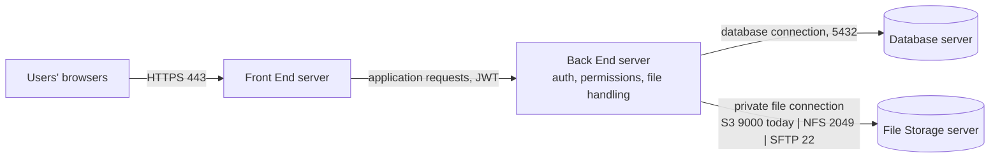

# Backend to File Storage: S3 (MinIO), NFS or SFTP?

> **Decision 2026-10-27: keep S3 to MinIO on `9000` and relay files through Rails (code on branch `feat/relay-attachments`, tests green, not yet released or deployed).** The Front End server also may not reach storage, and the FE proxies `/api` to the BE, so file URLs must be relative API paths. NFS, SFTP and the nginx stopgap are not used. Upload regression check: [`UPLOAD-REGRESSION-2026-10-27.md`](UPLOAD-REGRESSION-2026-10-27.md).
>
> *Original status line:* analysis for a decision with the client's management, 2026-10-27. Nothing here is applied. Management's
> diagram shows users reaching only the Front End, and the Back End handling every file over a "private file connection"
> to the File Storage server; they listed NFS (TCP 2049) and SFTP (TCP 22) as ways to build that connection. Related:
> [`ROUTE-FILES-THROUGH-APP-SERVER.md`](ROUTE-FILES-THROUGH-APP-SERVER.md), [`PLAN-SINGLE-PRIVATE-BUCKET.md`](PLAN-SINGLE-PRIVATE-BUCKET.md),
> [`FILE-ACCESS-SEQUENCE.md`](FILE-ACCESS-SEQUENCE.md).

## 1. What the diagram asks for, and what we have

Two separate questions are mixed in it:

1. **Who touches the storage server?** Only the Back End (users never do). 
2. **Over which protocol?** NFS or SFTP were suggested.

Question 1 is a design rule, and it is the right one. Question 2 already has an answer in production: the Back End talks
to MinIO over the **S3 API on TCP 9000**, which is row 4 of the client's own firewall table, is open, and is proven
(`db:prepare` uploaded 17 files). The list of options simply did not include it.

What is missing for question 1 is not a protocol but behaviour: today Rails answers a file request with a `302` to a
signed MinIO URL, so the **browser** talks to storage. The Back End has to serve the bytes itself (a "relay").

## 2. The options

| | S3 to MinIO (today) + relay | NFS (2049) | SFTP (22) | nginx forwards file paths (stopgap) |
|---|---|---|---|---|
| New firewall rule | none (9000 open) | yes, 2049 | yes, 22 App to Storage | none |
| Storage server | unchanged | **re-provision**: drop MinIO, export a directory | **re-provision**: SFTP account, chroot, keys | unchanged |
| Rails storage layer | unchanged (`aws-sdk-s3` already in use) | switch to the built-in `Disk` service on the mount | **write a custom Active Storage service** (needs a new gem such as `net-sftp`); none exists in Rails | unchanged |
| Rails relay code | **yes**: `AttachmentsController#show` sends bytes, Dictionary images move to the same endpoint, close the unauthenticated Active Storage routes (see the plan) | to verify: `Disk` URLs are served by Rails' own Disk routes, so the browser still never touches storage, but those routes check only a signed token (no Pundit, no audit), the same weakness the plan's section 2.3 describes | yes, as in the first column | no |
| Frontend change | **yes for Dictionary images** (they need the JWT, so no bare ``); vessels and documents mostly unchanged | same as the first column if Rails relays | same | none |
| Release needed | yes (code) | yes (config, plus the storage rebuild) | yes (new code) | no (nginx and `.env`) |
| Rough effort | days: code, tests, FE coordination | days of infrastructure plus config; permissions debugging | the most: custom service, tests, key management | about an hour, and it needs testing |

## 3. Pros and cons

**S3 to MinIO (keep) with relay**
- Pros: no new firewall rule and no change on the storage server; the connection is already open and proven; the S3 API gives integrity checksums, a per-bucket access policy and short-lived credentials per application; MinIO is a standard, well-supported Active Storage target; the design is already written ([`PLAN-SINGLE-PRIVATE-BUCKET.md`](PLAN-SINGLE-PRIVATE-BUCKET.md)); it removes the public bucket, so only one private bucket remains; every file read is authorised and can be logged.
- Cons: needs a code release and a frontend change for Dictionary images; Rails carries the bytes (files are small: 2, 5 and 10 MB limits), so downloads use App server bandwidth and a worker while they run; plain HTTP until TLS exists (same for every option).

**NFS**
- Pros: Rails reads and writes the files like a local folder; the built-in `Disk` service needs no custom code; NFSv4 uses a single port; fine on a private network.
- Cons: the storage server must be rebuilt around a shared directory, and MinIO and its setup (`mc-init`, two buckets, access keys) are dropped; **UID/GID ownership and mount options** must match between the App server, the containers and the NFS export, a frequent source of "permission denied"; NFSv4 with the default security sends data **unencrypted** and trusts the client's IP, so a firewall rule is the only protection (Kerberos fixes that and is heavy); a hung NFS server can **freeze Rails and the job worker** on file calls (hard mounts block), instead of returning an error; the Docker containers depend on a host mount being up; no object features (checksums, per-bucket policy); the existing MinIO data (only seed data today) would have to be moved or reseeded.

**SFTP**
- Pros: encrypted in transit; one well-known port (22) with simple, key-based, chroot-able accounts; no remote filesystem mounted on the App server.
- Cons: Rails has **no SFTP storage service**, so we would write and maintain one (upload, download, delete, existence, range reads, atomic writes through a temp name and rename, reconnect and timeout handling) and add a gem to the dependency audit; slower per file than S3 because of the SSH session; an SSH private key becomes a new secret on the App server; no checksums or object metadata; the storage server is rebuilt like in the NFS case. A FUSE mount (`sshfs`) avoids the custom code but is fragile inside containers, and we would not recommend it.

**nginx forwards file paths (stopgap)**
- Pros: no rule, no code, no release; removable in minutes.
- Cons: untested on these servers; files cross the App server twice; the browser still talks to the storage paths (through the App server's nginx), so it is not the "Back End handles files" design management drew, only a way to get images on screen until it exists.

## 4. Recommendation

Keep **S3 to MinIO on 9000** as the private file connection and build the **relay** (the plan already written). It gives
management exactly the picture they drew (users reach the Front End and, through it, the Back End; only the Back End talks
to storage), it needs no new firewall rule, and it avoids rebuilding the storage server or writing a storage driver.
NFS and SFTP each add infrastructure and, for SFTP, a custom driver, to reach a result we already have a working path to.

Until the relay is released, viewing files does not work for testers (uploads do), unless the stopgap is switched on.

## 5. To confirm with management

1. Is the requirement "only the Back End reaches storage" (satisfied by S3 over 9000 plus the relay), or specifically NFS or SFTP, and why? If it is a policy that names a protocol, which one and where is it written?
2. Is HTTPS on 443 (users to Front End) and the domain still planned right after deployment? The relay does not depend on it, but TLS between the Front End and Back End does.
3. Who owns the Front End change for Dictionary images, and can it ship in the same release as the relay?

## 6. What a switch would touch (if NFS or SFTP is chosen anyway)

`config/storage.yml` and `config/environments/production.rb` (service names), the storage server compose file and
`docker/mc-init.sh`, the backend `.env` (`MINIO_*` replaced), `db/seeds` (image uploads), `deploy/production/storage/`,
the firewall table, and this repo's deploy docs. Existing seeded files would be re-uploaded.
