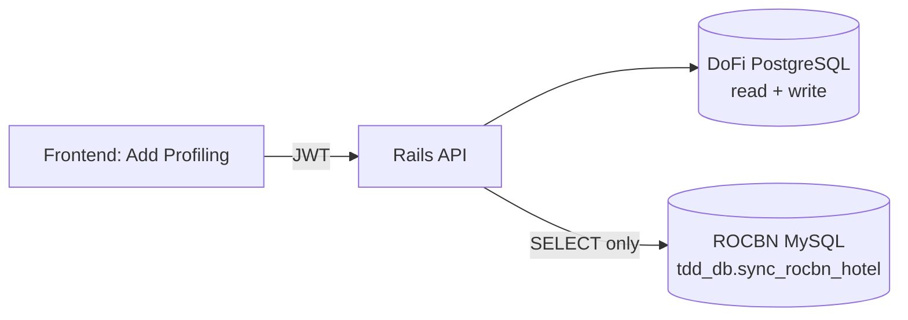
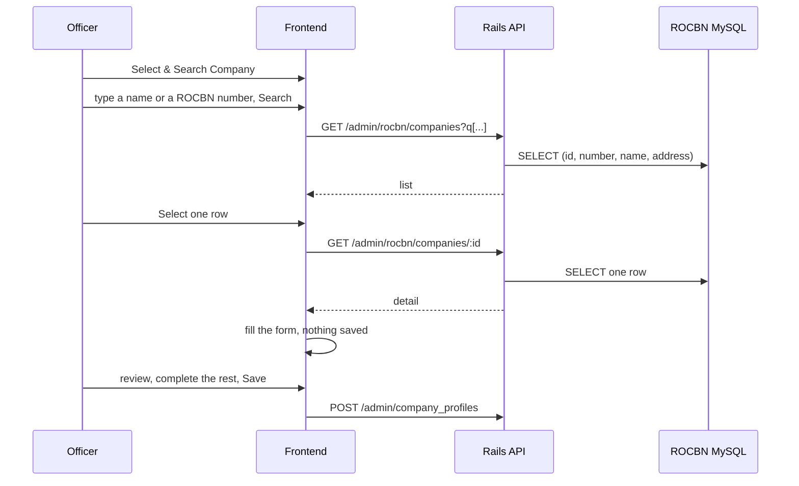
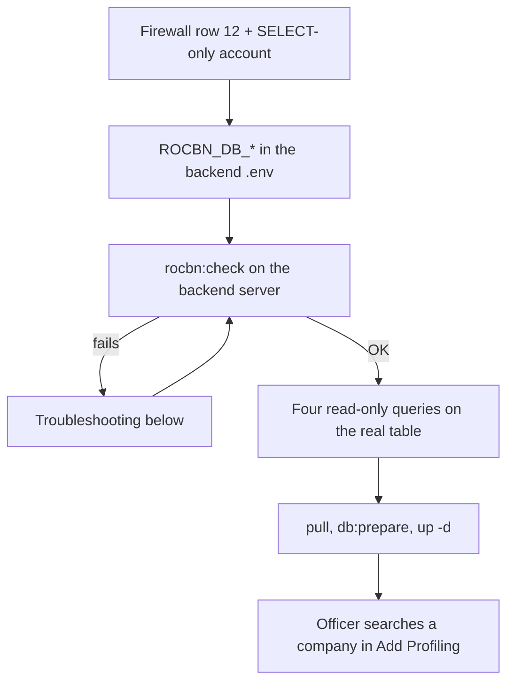

# ROCBN company lookup

Add Profiling's "Select & Search Company" step searches the national company registry (ROCBN) and autofills the new
profile from the chosen company. The registry is **one table, `tdd_db.sync_rocbn_hotel`, in a MySQL database owned by
another system**. We only read it: two endpoints, a second read-only connection, and a Docker MySQL stand-in for
local and staging. Saving the profile is the existing `POST /api/v1/admin/company_profiles`, unchanged.

| What | Where |
|---|---|
| Connection settings (per environment, from ENV) | [`config/rocbn.yml`](../../config/rocbn.yml) |
| Models | [`app/models/rocbn/`](../../app/models/rocbn/) (`BaseRecord`, `Company`, `NotProvidedText`) |
| Endpoints | [`Api::V1::Admin::Rocbn::CompaniesController`](../../app/controllers/api/v1/admin/rocbn/companies_controller.rb), [`RocbnCompanyPolicy`](../../app/policies/rocbn_company_policy.rb) |
| Table structure for the stand-in | [`db/rocbn/schema.sql`](../../db/rocbn/schema.sql) |
| Synthetic data, seed, diagnostics | [`db/rocbn/companies.yml`](../../db/rocbn/companies.yml), [`lib/rocbn/`](../../lib/rocbn/), [`lib/tasks/rocbn.rake`](../../lib/tasks/rocbn.rake) |

## 1. Architecture



| Environment | PostgreSQL | ROCBN registry |
|---|---|---|
| Local | `db` container | `rocbn-mysql` container, synthetic data |
| Staging (`RAILS_ENV=production`) | `db` container | `rocbn-mysql` container, synthetic data, isolated from production |
| Production | native, `10.252.8.23:5432` | the client's native MySQL, `10.252.8.23:9139`, real data |

The same models, controller and queries run everywhere; only the connection settings and the data differ.

**Why two databases.** PostgreSQL is DoFi's own data. The registry is another system's data in MySQL; copying it
(sync jobs, a second source of truth) was ruled out, so the API reads it where it lives. The registry connection is
therefore separate, read-only and optional: if MySQL is down the API still boots and serves everything else, and only
the lookup answers `503`.

## 2. Environment variables

| Variable | Used by | Notes |
|---|---|---|
| `ROCBN_DB_HOST`, `ROCBN_DB_PORT`, `ROCBN_DB_NAME` | runtime (all environments) | local/staging: `rocbn-mysql`, `3306`, `tdd_db`; production: `10.252.8.23`, `9139`, `tdd_db` |
| `ROCBN_DB_USERNAME`, `ROCBN_DB_PASSWORD` | runtime | the account must hold `SELECT` only. Local/staging: `rocbn_reader`. Production: what the client provides |
| `ROCBN_DB_SSL_MODE` | runtime, optional | default `preferred`: TLS when the server offers it, plain TCP otherwise |
| `ROCBN_SEED_DB_*` (`HOST`, `PORT`, `NAME`, `USERNAME`, `PASSWORD`) | `rocbn:seed` only | the stand-in's `rocbn_seed` account. **Never set in production**; the seed never reads `ROCBN_DB_*` |
| `ROCBN_ALLOW_SEED=yes` | `rocbn:seed` only | set on the command line for one run, never in a file |
| `ROCBN_TEST_DB_*` | tests only | the suite's own database (`tdd_db_test`). Tests never read `ROCBN_DB_*`, so a test run cannot reach a real registry |
| `ROCBN_MYSQL_ROOT_PASSWORD`, `ROCBN_MYSQL_HOST_PORT` | the `rocbn-mysql` container | passwords are interpolated into SQL: hex only (`openssl rand -hex 16`) |

Local defaults are in [`docker-compose.yml`](../../docker-compose.yml) (so nothing needs adding to `.env`) and
[`.env.example`](../../.env.example); staging reads its secrets from the server `.env`; production's are in
[`deploy/production/backend/.env.example`](../../deploy/production/backend/.env.example).

## 3. Docker MySQL (local and staging)

```bash
docker compose up -d rocbn-mysql                  # first start of an empty volume creates everything below
docker compose exec api bin/rails rocbn:check     # reachable, SELECT-only reader, table as expected
docker compose exec -e ROCBN_ALLOW_SEED=yes api bin/rails rocbn:seed
```

The first start loads [`db/rocbn/schema.sql`](../../db/rocbn/schema.sql) into `tdd_db`, then
[`docker/rocbn-mysql/02-users.sh`](../../docker/rocbn-mysql/02-users.sh) creates `rocbn_reader` (`SELECT` on that one
table) and the `tdd_db_test` database. To rebuild only this container's data (the PostgreSQL volume is untouched):

```bash
docker compose rm -sf rocbn-mysql && docker volume rm dofi-backend_dofi_rocbn_mysql_data
```

`docker-compose.production.local.yml` (the production image run locally) has no registry container: there the lookup
answers `503` unless `ROCBN_DB_*` in `.env.production` point at a MySQL that container can reach.

Staging: [`cd-staging.yml`](../../.github/workflows/cd-staging.yml) copies the init files, then starts the container and
runs the seed as a **non-fatal** last step: a MySQL problem can never block a staging deploy. The three secrets it needs
go into the server `.env` once ([`CI-CD-SETUP.md`](../ci-cd/CI-CD-SETUP.md) Part 2).

## 4. Table structure

[`db/rocbn/schema.sql`](../../db/rocbn/schema.sql) is the real table as read with `DESCRIBE` / `SHOW CREATE TABLE` /
`SHOW INDEX` on 2026-10-23, with `IF NOT EXISTS` added and the row counter dropped. It is loaded by the container's
init hook, by `rocbn:seed` and by the test support, and **never** against production. It is deliberately not a Rails
migration, and the connection is deliberately not in `database.yml`: `config/rocbn.yml` keeps the registry out of
`ActiveRecord::Base.configurations`, so `db:create`, `db:migrate`, `db:prepare`, `db:drop`, `db:truncate_all`,
`db:seed:replant` and the per-worker test databases cannot see it. A test pins this.

The table is denormalised: one row per company **and director/shareholder**. The person columns (`role`, `person_name`,
`identity_number`, `date_of_birth`, ...) are personal data the lookup never needs, so the model lists them in
`ignored_columns`: they cannot be selected, serialised or logged. Rows with `deleted_at` set (the registry's soft delete)
are never returned.

## 5. Seeding

`bin/rails rocbn:seed` creates the table if missing, then upserts about 57 fictional companies by primary key, so a rerun
updates the same rows and never duplicates. Ids start at 9,000,001, there is no randomness, and the data covers what the
lookup must handle: similar names (`q[company_name_cont]=amiirul` finds three), 35 numbered rows to page through
(`pagination`), the registry's placeholder markers, a soft-deleted row, a `[Ceased ...]` name, and `%`, `_`, `'`, `&` and
accented characters.

It refuses to run unless **all** of these hold ([`Rocbn::Seeding::Guard`](../../lib/rocbn/seeding/guard.rb)); it never
looks at `Rails.env`, because staging is `RAILS_ENV=production`:

1. `ROCBN_ALLOW_SEED=yes` is set for this run.
2. The host is `rocbn-mysql`, `localhost`, `127.0.0.1`, `::1` or `host.docker.internal`, and is not the production
   endpoint (`10.252.8.23` or port `9139`).
3. The target table is empty or holds only synthetic rows (no id below 9,000,000). An SSH tunnel to production looks like
   `localhost` to check 2; this check still refuses it.

It writes through its own `ROCBN_SEED_DB_*` account and reads nothing from `ROCBN_DB_*`. Change the data in
[`db/rocbn/companies.yml`](../../db/rocbn/companies.yml) and rerun (rows removed from the file stay until the container's
volume is rebuilt).

## 6. API

Both endpoints sit under `/api/v1/admin` (DoFi Officer and Jetty Manager platform), need a JWT, and are gated by the
`rocbn_companies.list` and `rocbn_companies.view` permissions (catalog section *Profiling*, granted by data migration to
roles that can create company profiles). Pagination and `q[...]` follow
[`search-filter-sort-pagination.md`](../api/search-filter-sort-pagination.md).

**Search** `GET /api/v1/admin/rocbn/companies`

| Param | Meaning |
|---|---|
| `q[company_name_cont]` | part of the name; case-insensitive; surrounding and repeated whitespace is squished; `%` and `_` match themselves |
| `q[rocbn_number_eq]` | the ROCBN number, exact, case-insensitive |
| `page`, `limit` | default 25 per page, at most 100 |

At least one criterion is required; both together narrow the result. A request with nothing usable (none, blank, unknown
names, or a filter that matches everything such as `company_name_present`) is answered `422`, never with the whole
registry. Results are always ordered by name, then id; client sorts are ignored.

```text
GET /api/v1/admin/rocbn/companies?q[company_name_cont]=Amiirul&page=1&limit=25
-> 200 { "status": "success",
         "data": [ { "id": "9000001", "rocbn_number": "RC90000001", "company_name": "AMIIRUL FISH CO.",
                     "company_address": "No. 1077, Spg 239-5 Jln Mumong Kuala Balai, Kuala Belait" } ],
         "meta": { "page": 1, "pages": 1, "count": 3, "limit": 25 } }
```

**Detail** `GET /api/v1/admin/rocbn/companies/:id`, where `:id` is the `id` from the list (the registry's own row id; the
company name and the ROCBN number are not unique enough to identify a row).

```text
-> 200 { "status": "success",
         "data": { "id": "9000001", "rocbn_number": "RC90000001", "company_name": "AMIIRUL FISH CO.",
                   "company_address": "No. 1077, Spg 239-5 Jln Mumong Kuala Balai, Kuala Belait",
                   "contact_number": "3331077", "district": "Belait", "mukim": "Kuala Belait", "village": "Kg Mumong" } }
```

| Status | When |
|---|---|
| 401 / 403 | no token / not an officer-platform user, or the permission is missing |
| 404 | unknown id, soft-deleted company, or an id that is not a number |
| 422 | no usable search criterion (`{ "status": "fail", "message": "Enter a company name or a ROCBN number to search." }`) |
| 503 | the registry is unreachable, timed out (5 s) or misconfigured; the message is generic and no SQL or host detail is returned |

## 7. Frontend workflow and Add Profiling mapping



Searching and selecting never write anywhere. Only after the detail request succeeds should the form be filled, and only
the fields below; every other field the officer typed stays as it is. Handle the loading, not-found (`404`) and failed
(`503`) states of both requests.

| Detail field | Add Profiling field | `company_profile` param | Registry column |
|---|---|---|---|
| `company_name` | Company Name | `company_name` | `name` |
| `company_address` | Company Address | `company_address` | `address_1`, `address_2`, `address_3`, joined with ", " |
| `rocbn_number` | ROCBN No./Business Name | `rocbn_no` | `registration_no` |
| `contact_number` | Contact No. | `contact_no` | `telp` (not `contact`, which holds an email or `N/A`) |
| `district` / `mukim` / `village` | District / Mukim / Village | `district` / `mukim` / `village` | same names |

Not filled from the lookup: DoFi Registration No. (generated), Registration Type, Mailing Address, the fishing gear
license fields, Worker Quota, Owner and Admin information.

**Limitations to design the form around**

- The registry marks missing values with `-`, `N/A` or `Not Specified`. The API turns them into `null` instead of
  passing them on. DoFi requires `contact_no`, `district`, `mukim` and `village` for non-individual registrations, so a
  field that comes back `null` must be left **editable**: do not lock autofilled fields.
- If the chosen company already has a DoFi profile (same `rocbn_no`), adding a second person is the existing flow; check
  with `GET /api/v1/admin/company_profiles?q[rocbn_no_eq]=...`. The lookup does not join PostgreSQL.
- Saving still trusts the values the form sends; there is no server-side re-check against the registry.
- Show the lookup only to officers holding `rocbn_companies.list`.

## 8. Read-only, in five independent layers

| Layer | What refuses a write |
|---|---|
| Database account | `SELECT` on `tdd_db.sync_rocbn_hotel` only (the container's `rocbn_reader`; the client's account in production). `rocbn:check` warns if it holds more |
| Adapter | `replica: true` in `config/rocbn.yml`: ActiveRecord raises `ReadOnlyError` for any write query, `delete_all`, `insert_all` and raw SQL included |
| Model | `Rocbn::Company#readonly?` is `true`; the director/shareholder columns are not even loaded |
| Rails tooling | the connection is outside `database.yml`, so no `db:*` task or test database setup can reach it |
| Seeding | the guard in section 5, which only ever writes to a local, synthetic database |

## 9. Switching from Docker MySQL to the production MySQL

Nothing in code changes. Set the runtime variables and nothing else:

| | Docker (local, staging) | Production |
|---|---|---|
| `ROCBN_DB_HOST` / `ROCBN_DB_PORT` | `rocbn-mysql` / `3306` | `10.252.8.23` / `9139` |
| `ROCBN_DB_NAME` | `tdd_db` | `tdd_db` |
| account | `rocbn_reader` (`SELECT` only) | the client's account, `SELECT` only, allowed from `10.252.8.12` |
| `ROCBN_SEED_*`, `ROCBN_ALLOW_SEED`, `ROCBN_TEST_*` | set | **absent** |
| container, schema load, seed | yes | none: not deployed, not run, not allowed by the guard |

## 10. Production deployment

1. Firewall row 12 (`10.252.8.12` to `10.252.8.23:9139`) and the MySQL account: see
   [`production-4-server-architecture.md`](../architecture/production-4-server-architecture.md) §3 and the
   [checklist](../ci-cd/PRODUCTION-DEPLOY-CHECKLIST.md) (sections A, C3, D).
2. Put the `ROCBN_DB_*` values in the backend `.env`, then run `docker compose run --rm --no-deps api bin/rails rocbn:check`
   from the backend server. This is also the connectivity proof ([`NETWORK-CONNECTIVITY-CHECK.md`](../ci-cd/NETWORK-CONNECTIVITY-CHECK.md)).
3. The permissions arrive with `db:prepare` (data migration `AddRocbnCompanyPermissions`); no seed runs in production.
4. Before relying on it, run these read-only queries on the real table and compare with the defaults above:

```sql
SELECT COUNT(*) - COUNT(DISTINCT registration_no) FROM sync_rocbn_hotel;   -- >0: a company can list twice
SELECT status, COUNT(*) FROM sync_rocbn_hotel GROUP BY status;             -- ceased or unregistered rows (no status filter today)
SELECT telp, COUNT(*) FROM sync_rocbn_hotel GROUP BY telp ORDER BY 2 DESC LIMIT 15;  -- likewise mukim, village, district
SELECT COUNT(*) FROM sync_rocbn_hotel WHERE deleted_at IS NOT NULL;
```

Name search is an infix `LIKE`, which cannot use the `name` index: about 0.1 to 0.2 s per query on 185,000 rows (the page
and the count are two scans), bounded by a 5 s server-side limit and the global per-IP throttle. No index is created on the
production table without the client's approval. MySQL 8.0 reached upstream end-of-life in April 2026; keeping the
production server patched is the client's.

## 11. Running the project against the external database

"External" means the MySQL is not ours: the application only reads one table from it. This is the go-live runbook for
the production backend server (`10.252.8.12`); sections 9 and 10 explain what changes and why.

### 11.1 Before go-live (needs the client and you)

| # | Step | Who | Done when |
|---|---|---|---|
| 1 | Request firewall row 12: `10.252.8.12` to `10.252.8.23:9139` ([architecture §3](../architecture/production-4-server-architecture.md)) | you, to the client's network team | `nc -zv 10.252.8.23 9139` from the backend server succeeds ([`NETWORK-CONNECTIVITY-CHECK.md`](../ci-cd/NETWORK-CONNECTIVITY-CHECK.md)) |
| 2 | Ask for a MySQL account with `SELECT` on `tdd_db.sync_rocbn_hotel` only, allowed from `10.252.8.12` (`'<account>'@'10.252.8.12'`) | client's DBA | you hold the username and password |
| 3 | Put the five `ROCBN_DB_*` values in the backend server's `.env` ([`.env.example`](../../deploy/production/backend/.env.example)) | engineer, in the Delinea session | `docker compose config` shows them |
| 4 | Run `docker compose run --rm --no-deps api bin/rails rocbn:check` on the backend server | engineer | it prints `OK`, the server version, the account and `SELECT only` |
| 5 | Run the four read-only queries of section 10 on the real table | client's DBA or you | the defaults in sections 4 and 7 still hold (duplicates, status values, placeholders, soft-deleted count) |
| 6 | Deploy as usual (`pull`, `db:prepare`, `up -d`): the data migration grants `rocbn_companies.list`/`.view` | engineer | `GET /api/v1/admin/rocbn/companies?q[company_name_cont]=...` answers `200` for an officer |

Production environment variables, and nothing else for this feature:

```bash
ROCBN_DB_HOST=10.252.8.23
ROCBN_DB_PORT=9139
ROCBN_DB_NAME=tdd_db
ROCBN_DB_USERNAME=<account from the client>
ROCBN_DB_PASSWORD=<password from the client>
```

Never set `ROCBN_SEED_*`, `ROCBN_TEST_*` or `ROCBN_ALLOW_SEED` on the backend server. Without them the seed cannot run,
and the guard in section 5 refuses the production endpoint anyway.



### 11.2 Day-to-day and after the deploy

- The registry being down never takes the API down: only the lookup answers `503` (the form can still be filled by
  hand). Fix the cause with `rocbn:check` and the Troubleshooting table; no restart of `api` is needed once the
  database is reachable again (the connection pool reconnects on the next request).
- Changing the account or password: edit the server `.env`, then `docker compose up -d` (a restart of `api` reads it).
- Rolling back the deploy needs nothing for this feature: the table is never written, and the two permissions stay
  harmlessly in `permissions`.
- Staging uses the Docker stand-in (`rocbn-mysql`) with synthetic data, never the real registry.

### 11.3 Running a developer machine against another MySQL

The default (`docker compose up`) already wires the app to the local stand-in. To aim your local `api` at a different
MySQL instead (for example another stand-in), override the runtime variables only, in an untracked
`docker-compose.override.yml`:

```yaml
services:
  api:
    environment:
      ROCBN_DB_HOST: <host>
      ROCBN_DB_PORT: <port>
      ROCBN_DB_USERNAME: <select-only account>
      ROCBN_DB_PASSWORD: <password>
```

Then `docker compose up -d api` and `docker compose exec api bin/rails rocbn:check`. Rules that do not bend: use a
`SELECT`-only account; do not point it at the real registry from a laptop (it is reachable from the backend server
only); the tests and the seed keep using `ROCBN_TEST_DB_*` / `ROCBN_SEED_DB_*`, so they stay on the local container.
This override path is not exercised by CI.

## 12. Known limits and future improvements

Each row is accepted today and says what to change if it starts to matter.

| Limit | Consequence | Improvement, when needed |
|---|---|---|
| Placeholder values (`-`, `N/A`, `Not Specified`, blank) are returned as `null` | many companies come back without mukim, village or contact, and DoFi requires them for non-individual profiles | the frontend must keep those fields editable (section 7). If the real data shows other placeholders, extend `Rocbn::NotProvidedText::MARKERS` |
| Name search is an infix `LIKE '%x%'` | it cannot use the `name` index: about 0.1 to 0.2 s per query on 185,000 rows (the page and the count are two scans), bounded by `max_execution_time` 5 s and the per-IP throttle | a prefix search (`name LIKE 'x%'`) or a FULLTEXT index on `name`, both of which need the client's approval on their table; or require a minimum search length |
| No index is added to the production table | as above; we only read | ask the client's DBA for the index rather than creating it ourselves |
| No filter on `status` | ceased or unregistered companies can be listed (the `deleted_at` rows are hidden) | decide with DoFi which statuses are selectable, once the `GROUP BY status` result is known; then add a scope to `Rocbn::Company` |
| `registration_no` is not unique in the table | a company with several directors can repeat (the table is one row per person) | if the duplicate query returns more than 0, group by `registration_no` in `for_listing` |
| Saving still trusts the values the frontend sends | an officer could save a profile that does not match the registry | re-check `rocbn_no` against the registry inside `CompanyProfiles` creation (a service call, not a join) |
| No cache | every search and every selection hits the external MySQL | cache a detail by `id` in Solid Cache for a few minutes, if the registry's load or latency becomes a concern |
| One account, no retry | one failed connection answers `503`; the officer retries | a single retry on `ConnectionNotEstablished` in `Rocbn::BaseRecord`, if the network proves flaky |
| TLS and authentication plugin are untested against the real server | `ssl_mode` defaults to `preferred` | `rocbn:check` from the backend server settles it; set `ROCBN_DB_SSL_MODE=required` if the client wants TLS enforced |
| MySQL 8.0 reached upstream end-of-life in April 2026 | the stand-in image is no longer patched upstream | move the stand-in to a supported release when `rocbn:check` against the client's version shows it is safe; patching the production server is the client's |
| The CI MySQL service and the staging seed step have not run on GitHub yet | a first run can still fail on workflow details | watch the first CI run of this change and the next push to `develop`; the staging seed step is non-fatal by design |
| `bin/ci` needs the `rocbn-mysql` container locally | `bin/ci` also runs `db:drop`, so it was not run on a developer machine for this change | start the container first (`docker compose up -d rocbn-mysql`), then run it as usual |

## Troubleshooting

`bin/rails rocbn:check` is the first step everywhere. It only reads, and never prints the password.

| Symptom | Likely cause and fix |
|---|---|
| The lookup answers `503` | the registry is unreachable or slow: run `rocbn:check`, then see below. The rest of the API is unaffected |
| `Connection refused`, `Can't connect`, a timeout | firewall (production row 12), a wrong `ROCBN_DB_HOST` / `ROCBN_DB_PORT`, or the `rocbn-mysql` container is not running or not healthy yet (`docker compose ps`) |
| `Access denied` | wrong account or password, or the account is not allowed from this server's address |
| an authentication plugin error | the account's plugin could not be negotiated; trilogy 2.11+ handles `caching_sha2_password` and `mysql_native_password` |
| `table FAILED ... lacks: <column>` | the registry's table changed; the lookup needs the columns listed in `Rocbn::Check::REQUIRED_COLUMNS` |
| `rocbn:seed` is refused | read the reasons it prints: missing `ROCBN_ALLOW_SEED=yes`, a non-local host, or a database that is not synthetic |
| ROCBN tests are skipped locally | MySQL is not reachable: `docker compose up -d rocbn-mysql`. Under `CI` they fail instead of skipping |
| MySQL container starts, then exits | a missing or non-hex password in `.env`, or a stale volume from older settings (rebuild only that volume, section 3) |
